# Fighter Roster

Generated from `Roster.cs` with `dotnet run --project tools/TarkamArena.Tools -- docs`.

## Professions

### Bang Jarot — The Traffic Light Drifter

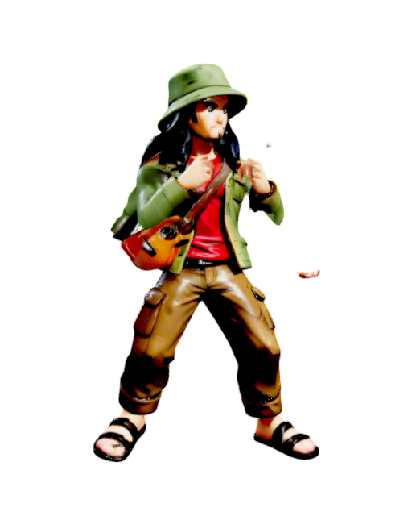
*From: Jakarta · Style: Striker · Power/Speed/Defense/Technique: 5/8/4/7*

Jarot has lived at the same crossroads for twenty years. He knows every light cycle by heart and fights like the traffic: stop, wait, then all at once.

> Spare a little? No? Then take this!

- **S**: Tin Can Toss · **→ S**: Red Light Somersault · **↓ S**: Busker's Smash

| Input | Signature move | Kind | Meter | Effect |
|---|---|---|---|---|
| `↓ ↘ → + S` | **Tin Can Rain** | Barrage | 250 | A volley of dented cans and bottle caps. |
| `↓ ↙ ← + S` | **Buskers' Charge** | Crowd charge | 400 | Every busker at the crossroads storms in with ukuleles. |
| `↓ ↓ + S` | **Traffic Light Slam** | Signature weapon | 700 | Rips out the traffic light and swings it, lights still blinking. |

| Input | Kind | Finisher |
|---|---|---|
| `← ← → H` | Fatality | Green Means Go |
| `↓ → ↓ H` | Fatality | Rush Hour Pileup |
| `↑ ↓ → H` | Fatality | Coin Rain |
| `← → ← L` | Brutality | Window Washer |
| `→ ← → L` | Brutality | Busker Encore |
| `← ← ← S` | Friendship | Shared Rice Box |
| `→ → → S` | Friendship | Street Duet |
| `← ← ↓ G` | Mercy | Spare Change |
| `→ ↓ ← H` | Legendary Finisher | King of the Crossroads |

### Mbak Sinta — The Minimarket Cashier

*From: Bekasi · Style: Striker · Power/Speed/Defense/Technique: 4/9/5/7*

Sinta has scanned a million items and smiled through every one. Her greeting is legendary; so is the speed of her elbow.

> Would you like to top up too, sis?

- **S**: Receipt Whip · **→ S**: Barcode Dash · **↓ S**: Cash Drawer Ding

| Input | Signature move | Kind | Meter | Effect |
|---|---|---|---|---|
| `↓ ↘ → + S` | **Receipt Storm** | Barrage | 250 | Razor-sharp receipts fired from the till. |
| `↓ ↙ ← + S` | **Promo Stampede** | Crowd charge | 400 | Shoppers chasing a two-for-one deal trample everything. |
| `↓ ↓ + S` | **Trolley of Doom** | Signature weapon | 700 | A fully loaded shopping trolley, swung like a hammer. |

| Input | Kind | Finisher |
|---|---|---|
| `↓ ← → H` | Fatality | Price Check |
| `→ → ← H` | Fatality | Void Transaction |
| `← → ↓ H` | Fatality | Shelf Restock |
| `↑ → ↓ L` | Brutality | Bag It Up |
| `↓ ↓ → L` | Brutality | Member Points |
| `← ← ← S` | Friendship | Free Sample |
| `→ → → S` | Friendship | Buy One Get One |
| `↓ ↓ ↓ G` | Mercy | Exact Change |
| `← ↑ → H` | Legendary Finisher | Grand Opening Sale |

### Pak Darmo — The Math Teacher

*From: Yogyakarta · Style: Mystic · Power/Speed/Defense/Technique: 5/5/6/9*

Thirty-one years of teaching, and not one student has escaped his chalk. Pak Darmo calculates the angle of every throw before it leaves his hand.

> Turn to page forty-seven.

- **S**: Chalk Sniper · **→ S**: Wooden Ruler Lunge · **↓ S**: Pop Quiz

| Input | Signature move | Kind | Meter | Effect |
|---|---|---|---|---|
| `↓ ↘ → + S` | **Chalk Machine Gun** | Barrage | 250 | Thirty years of aim, all at once. |
| `↓ ↙ ← + S` | **Falling Formulas** | Weather strike | 400 | Blackboards full of equations rain from the sky. |
| `↓ ↓ + S` | **Giant Ruler** | Signature weapon | 700 | A one-metre ruler, enlarged to five. |

| Input | Kind | Finisher |
|---|---|---|
| `↓ ← → H` | Fatality | Division by Zero |
| `→ → ← H` | Fatality | Pythagorean Fold |
| `↓ → ↓ H` | Fatality | Final Exam |
| `↓ ↓ → L` | Brutality | Show Your Work |
| `→ ← → L` | Brutality | Homework Avalanche |
| `→ → → S` | Friendship | Extra Credit |
| `↑ ↑ → S` | Friendship | Field Trip |
| `← ← ↓ G` | Mercy | Remedial Class |
| `← ↑ → H` | Legendary Finisher | Theorem of Legends |

### Mas Rangga — The Silat Master

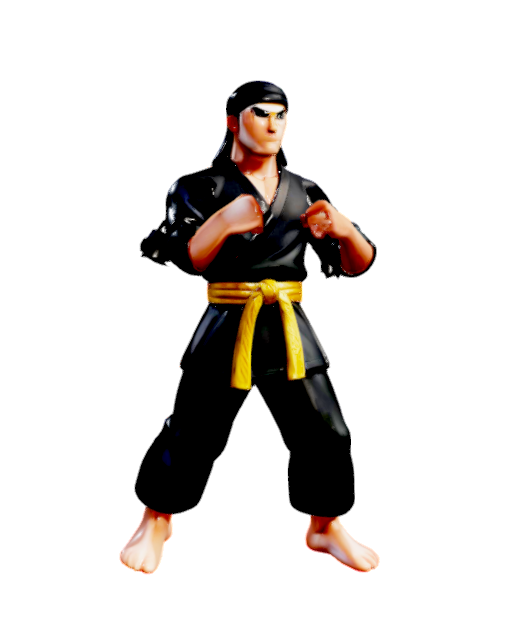
*From: Padang · Style: Striker · Power/Speed/Defense/Technique: 6/8/6/10*

Rangga trained in a surau courtyard before dawn every day of his childhood. His silat is patient, low and devastating.

> Silat is not for showing off.

- **S**: Tiger Stance · **→ S**: Crescent Kick · **↓ S**: Joint Lock

| Input | Signature move | Kind | Meter | Effect |
|---|---|---|---|---|
| `↓ ↘ → + S` | **Silat Whirlwind** | Tornado | 250 | A spinning kick that becomes a typhoon. |
| `↓ ↙ ← + S` | **Spirit Tiger** | Summon | 400 | The tiger of his school's legend leaps out to strike. |
| `↓ ↓ + S` | **Inner Power** | Lift & slam | 700 | Lifts the opponent with pure inner power and drops them. |

| Input | Kind | Finisher |
|---|---|---|
| `↓ ← → H` | Fatality | Falling Leaf |
| `← → ↓ H` | Fatality | Thousand Steps |
| `↑ ↓ → H` | Fatality | Spine of the Tiger |
| `→ ← → L` | Brutality | Elbow Rain |
| `← → ← L` | Brutality | Sweeping River |
| `→ → → S` | Friendship | Bow of Respect |
| `↑ ↑ → S` | Friendship | Training Partner |
| `↓ ↓ ↓ G` | Mercy | Spared by Honour |
| `→ ↓ ← H` | Legendary Finisher | Spirit of the Ancestors |

### Bang Codet — The Market Thug

*From: Medan · Style: Grappler · Power/Speed/Defense/Technique: 9/4/7/4*

Every stall in the market pays Codet's 'security fee'. He has a scar for every argument he won, and he has won all of them.

> You're on my turf now.

- **S**: Shakedown · **→ S**: Stall Charge · **↓ S**: Market Slam

| Input | Signature move | Kind | Meter | Effect |
|---|---|---|---|---|
| `↓ ↘ → + S` | **Market Gang** | Crowd charge | 250 | Codet whistles and the whole gang comes running. |
| `↓ ↙ ← + S` | **Bamboo Club** | Signature weapon | 400 | A bamboo pole straight from the stall frame. |
| `↓ ↓ + S` | **Lift and Slam** | Lift & slam | 700 | Hoists the opponent over his head and slams them. |

| Input | Kind | Finisher |
|---|---|---|
| `→ → ← H` | Fatality | Protection Fee |
| `← ← → H` | Fatality | Closing Time |
| `↓ ← → H` | Fatality | Fish Market Toss |
| `→ ← → L` | Brutality | Overturned Stall |
| `↓ ↓ → L` | Brutality | Scar Collection |
| `↑ ↑ → S` | Friendship | Market Discount |
| `↓ ↑ ↓ S` | Friendship | Lifting Buddy |
| `↓ ↓ ↓ G` | Mercy | Debt Forgiven |
| `↑ ↑ ↓ H` | Legendary Finisher | Lord of the Market |

### Bang Priit — The Parking Attendant

*From: Surabaya · Style: Brawler · Power/Speed/Defense/Technique: 5/7/5/6*

Nobody sees Priit arrive, but he is always there when you leave. His whistle can stop a truck and his footwork can stop you.

> Left, left, keep going... stop!

- **S**: Whistle Blast · **→ S**: Reverse, Reverse · **↓ S**: Two Thousand Fee

| Input | Signature move | Kind | Meter | Effect |
|---|---|---|---|---|
| `↓ ↘ → + S` | **Sonic Whistle** | Wave | 250 | A whistle so loud it knocks people over. |
| `↓ ↙ ← + S` | **Illegal Parking** | Crowd charge | 400 | A row of motorbikes reverses out all at once. |
| `↓ ↓ + S` | **Parking Barrier** | Signature weapon | 700 | The striped barrier arm swings down. No ticket, no exit. |

| Input | Kind | Finisher |
|---|---|---|
| `↑ ↓ → H` | Fatality | Tow Away Zone |
| `← → ↓ H` | Fatality | Double Parked |
| `↓ ← → H` | Fatality | Final Whistle |
| `↓ ↓ → L` | Brutality | Left, Left, Keep Going |
| `← → ← L` | Brutality | Wheel Clamp |
| `↓ ↑ ↓ S` | Friendship | Free Parking |
| `← ← ← S` | Friendship | Help Push Start |
| `← ← ↓ G` | Mercy | No Charge Today |
| `← ↑ → H` | Legendary Finisher | Guardian of Every Lot |

### Pak Slamet — The Neighbourhood Guard

*From: Depok · Style: Grappler · Power/Speed/Defense/Technique: 7/4/9/5*

Slamet has guarded the same gate through floods, blackouts and three mayors. He never sleeps on the night shift, or so he says.

> ID card, please.

- **S**: Baton Strike · **→ S**: Night Patrol · **↓ S**: Alarm Gong

| Input | Signature move | Kind | Meter | Effect |
|---|---|---|---|---|
| `↓ ↘ → + S` | **Night Shift Baton** | Signature weapon | 250 | The baton he has polished for twenty years. |
| `↓ ↙ ← + S` | **Village Patrol** | Crowd charge | 400 | Neighbours with kentongan drums sweep the street. |
| `↓ ↓ + S` | **Gate Slam** | Quake | 700 | Slams the complex gate so hard the ground shakes. |

| Input | Kind | Finisher |
|---|---|---|
| `↓ ← → H` | Fatality | Gate Closed |
| `→ → ← H` | Fatality | Curfew |
| `↓ → ↓ H` | Fatality | Lights Out |
| `↓ ↓ → L` | Brutality | Guest Book Slam |
| `→ ← → L` | Brutality | Patrol Round |
| `← ← ← S` | Friendship | Hot Coffee Break |
| `↓ ↑ ↓ S` | Friendship | Neighbourhood Watch |
| `← ← ↓ G` | Mercy | Let Through |
| `↑ ↑ ↓ H` | Legendary Finisher | Guardian of the Gate |

### Mas Kumis — The Meatball Vendor

*From: Wonogiri · Style: Brawler · Power/Speed/Defense/Technique: 7/5/6/6*

Kumis pushes a cart heavier than a motorbike up every hill in town. The broth is hot, the fists are hotter.

> Meatballs! Spicy ones too!

- **S**: Meatball Barrage · **→ S**: Runaway Cart · **↓ S**: Hot Broth Splash

| Input | Signature move | Kind | Meter | Effect |
|---|---|---|---|---|
| `↓ ↘ → + S` | **Meatballs Galore** | Barrage | 250 | Meatballs that split into more meatballs. |
| `↓ ↙ ← + S` | **Broth Flood** | Wave | 400 | A tidal wave of scalding, spicy broth. |
| `↓ ↓ + S` | **Runaway Cart** | Signature weapon | 700 | The cart, the bowls, the stove, all of it. |

| Input | Kind | Finisher |
|---|---|---|
| `↓ → ↓ H` | Fatality | Extra Spicy |
| `← ← → H` | Fatality | Bowl Smash |
| `↓ ← → H` | Fatality | Mega Meatball |
| `↑ → ↓ L` | Brutality | Noodle Lasso |
| `↓ ↓ → L` | Brutality | Bell of Doom |
| `→ → → S` | Friendship | Free Refill |
| `↓ ↑ ↓ S` | Friendship | Late Night Snack |
| `↓ ↓ ↓ G` | Mercy | Pay Tomorrow |
| `→ ↓ ← H` | Legendary Finisher | Emperor of Broth |

### Bu Ratna — The Neighbourhood Mom

*From: Bandung · Style: Brawler · Power/Speed/Defense/Technique: 6/6/7/7*

Ratna runs the arisan, the WhatsApp group and the whole street. Her left indicator means she is turning right, and nobody dares argue.

> I've told you a hundred times!

- **S**: Homing Flip-Flop · **→ S**: Left Signal, Right Turn · **↓ S**: Endless Scolding

| Input | Signature move | Kind | Meter | Effect |
|---|---|---|---|---|
| `↓ ↘ → + S` | **Homing Sandals** | Barrage | 250 | Flip-flops that always find the naughty one. |
| `↓ ↙ ← + S` | **Arisan Gang** | Crowd charge | 400 | The moms ride in on scooters, left signal on, turning right. |
| `↓ ↓ + S` | **Ear Pull** | Lift & slam | 700 | Lifted by the ear, then sat down very firmly. |

| Input | Kind | Finisher |
|---|---|---|
| `← → ↓ H` | Fatality | The Wooden Spoon |
| `↑ ↓ → H` | Fatality | Group Chat Exposed |
| `← ← → H` | Fatality | Laundry Line |
| `↓ ↓ → L` | Brutality | Sandal Boomerang |
| `↑ → ↓ L` | Brutality | Arisan Collection |
| `← ← ← S` | Friendship | Have You Eaten? |
| `↓ ↑ ↓ S` | Friendship | Gossip Session |
| `↓ ↓ ↓ G` | Mercy | Just This Once |
| `← ↑ → H` | Legendary Finisher | Queen of the Complex |

## Mystic Creatures

### Kunti — The Weeping Lady

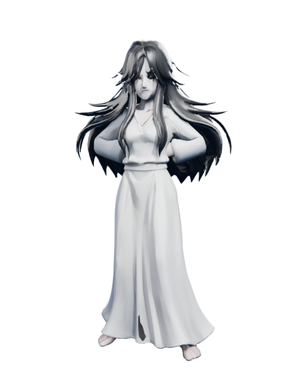
*From: Pontianak · Style: Mystic · Power/Speed/Defense/Technique: 6/8/4/8*

Her laugh carries across rivers. When it sounds far away she is right behind you; when it sounds close, run.

> Hihihihi...

- **S**: Piercing Laughter · **→ S**: Drifting Flight · **↓ S**: Midnight Claw

| Input | Signature move | Kind | Meter | Effect |
|---|---|---|---|---|
| `↓ ↘ → + S` | **Twin Kunti** | Summon | 250 | Her sisters drift out of the trees, laughing. |
| `↓ ↙ ← + S` | **Hair Snare** | Lift & slam | 400 | Her hair coils around the victim and lifts them up. |
| `↓ ↓ + S` | **Thursday Night** | Weather strike | 700 | A blood-red moon and lightning that only strikes the brave. |

| Input | Kind | Finisher |
|---|---|---|
| `↑ ↓ → H` | Fatality | Hair Cocoon |
| `→ → ← H` | Fatality | Banana Tree Ambush |
| `↓ → ↓ H` | Fatality | Last Laugh |
| `↑ → ↓ L` | Brutality | Nail Flurry |
| `← → ← L` | Brutality | River Mist |
| `↓ ↑ ↓ S` | Friendship | Lullaby |
| `→ → → S` | Friendship | Hair Care Day |
| `← ← ↓ G` | Mercy | Fade Away |
| `← ↑ → H` | Legendary Finisher | Queen of the Night |

### Pocong Joni — The Bound Spirit

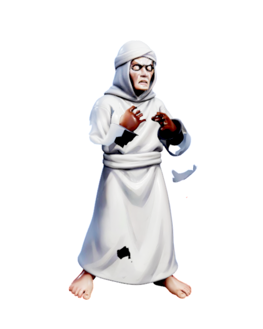
*From: Solo · Style: Brawler · Power/Speed/Defense/Technique: 7/5/6/5*

Joni's ties were never untied, so he hops. He has hopped for so long that his legs, wherever they are, are terrifyingly strong.

> Untie me... please...

- **S**: Shroud Hop · **→ S**: Shroud Roll · **↓ S**: Binding Knot

| Input | Signature move | Kind | Meter | Effect |
|---|---|---|---|---|
| `↓ ↘ → + S` | **Pocong Army** | Crowd charge | 250 | A whole graveyard hops across the arena. |
| `↓ ↙ ← + S` | **Shroud Tornado** | Tornado | 400 | Spins so fast his shroud becomes a whirlwind. |
| `↓ ↓ + S` | **Graveyard Hop** | Quake | 700 | One enormous hop, one enormous landing. |

| Input | Kind | Finisher |
|---|---|---|
| `← → ↓ H` | Fatality | Final Hop |
| `↓ ← → H` | Fatality | Wrapped Up |
| `→ → ← H` | Fatality | Graveyard Bounce |
| `↓ ↓ → L` | Brutality | Headbutt Barrage |
| `← → ← L` | Brutality | Rolling Thunder |
| `← ← ← S` | Friendship | Untie Me Please |
| `↓ ↑ ↓ S` | Friendship | Hopscotch |
| `↓ ↓ ↓ G` | Mercy | Hop Away |
| `← ↑ → H` | Legendary Finisher | King of the Cemetery |

### Buto Ijo — The Green Giant

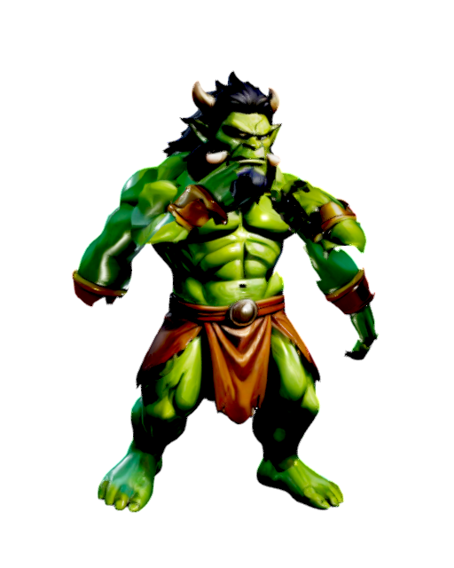
*From: Jawa Tengah · Style: Grappler · Power/Speed/Defense/Technique: 10/3/8/3*

A hungry giant from the old tales, once outwitted by Timun Mas. He has been waiting a very long time for a rematch.

> I smell something tasty...

- **S**: Giant's Roar · **→ S**: Earth Pound · **↓ S**: Swallow Whole

| Input | Signature move | Kind | Meter | Effect |
|---|---|---|---|---|
| `↓ ↘ → + S` | **Giant's Stomp** | Quake | 250 | The earth cracks under one green foot. |
| `↓ ↙ ← + S` | **Boulder Toss** | Barrage | 400 | River boulders, thrown like pebbles. |
| `↓ ↓ + S` | **Giant's Grip** | Lift & slam | 700 | Picks the opponent up like a snack, then changes his mind. |

| Input | Kind | Finisher |
|---|---|---|
| `↓ → ↓ H` | Fatality | Cucumber Revenge |
| `↓ ← → H` | Fatality | Mountain Stomp |
| `← ← → H` | Fatality | Giant Appetite |
| `← → ← L` | Brutality | Ground and Pound |
| `→ ← → L` | Brutality | Boulder Toss |
| `← ← ← S` | Friendship | Snack Time |
| `↓ ↑ ↓ S` | Friendship | Gentle Giant |
| `← ← ↓ G` | Mercy | Not Hungry Today |
| `→ ↓ ← H` | Legendary Finisher | Titan of Java |

### Genderuwo — The Forest Shadow

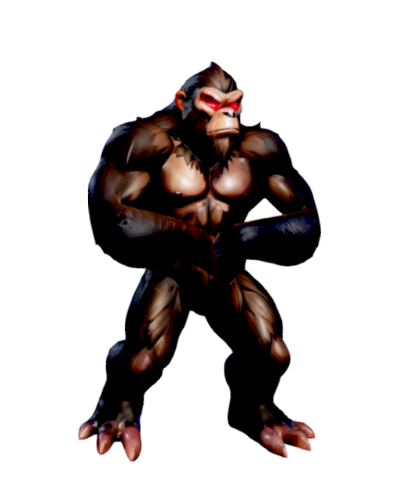
*From: Jawa Timur · Style: Grappler · Power/Speed/Defense/Technique: 9/4/7/5*

A shaggy shadow that lives in old banyan trees. It throws stones at those who disrespect the forest, and it never misses.

> Respect the old trees.

- **S**: Hurled Stone · **→ S**: Shadow Lunge · **↓ S**: Dark Grip

| Input | Signature move | Kind | Meter | Effect |
|---|---|---|---|---|
| `↓ ↘ → + S` | **Phantom Stones** | Barrage | 250 | Stones thrown by nobody, from nowhere. |
| `↓ ↙ ← + S` | **Forest Shadows** | Summon | 400 | Shaggy shadows peel off the trees and pounce. |
| `↓ ↓ + S` | **Banyan's Wrath** | Weather strike | 700 | The old banyan drops its heaviest branches. |

| Input | Kind | Finisher |
|---|---|---|
| `↓ ← → H` | Fatality | Banyan Embrace |
| `→ → ← H` | Fatality | Stone Storm |
| `↑ ↓ → H` | Fatality | Eyes in the Dark |
| `→ ← → L` | Brutality | Shaggy Slam |
| `↓ ↓ → L` | Brutality | Forest Toss |
| `← ← ← S` | Friendship | Tree Planting |
| `↑ ↑ → S` | Friendship | Firefly Night |
| `← ← ↓ G` | Mercy | Leave the Forest |
| `→ ↓ ← H` | Legendary Finisher | Lord of the Banyan |

### Wewe Gombel — The Hiding Mother

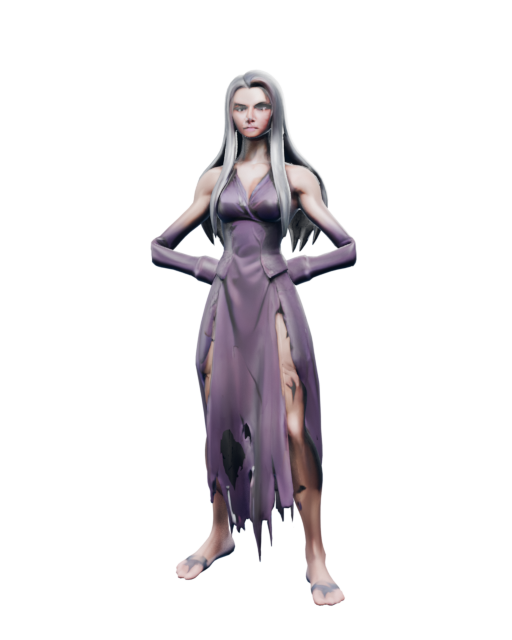
*From: Semarang · Style: Mystic · Power/Speed/Defense/Technique: 6/6/6/8*

She hides neglected children from careless parents and returns them only when they are missed. Her long arms reach further than you think.

> Who forgot you, little one?

- **S**: Treetop Vanish · **→ S**: Long Embrace · **↓ S**: Mournful Cry

| Input | Signature move | Kind | Meter | Effect |
|---|---|---|---|---|
| `↓ ↘ → + S` | **Long Embrace** | Lift & slam | 250 | Arms that reach across the arena and carry you off. |
| `↓ ↙ ← + S` | **The Lost Children** | Summon | 400 | The children she hid come out to play rough. |
| `↓ ↓ + S` | **Gombel Fog** | Weather strike | 700 | A cold fog that strikes from above. |

| Input | Kind | Finisher |
|---|---|---|
| `↓ → ↓ H` | Fatality | Hide and Never Seek |
| `← → ↓ H` | Fatality | Gombel Hill |
| `↓ ← → H` | Fatality | Long Reach |
| `↓ ↓ → L` | Brutality | Branch Whip |
| `← → ← L` | Brutality | Lost and Found |
| `← ← ← S` | Friendship | Bedtime Story |
| `↓ ↑ ↓ S` | Friendship | Family Reunion |
| `← ← ↓ G` | Mercy | Go Home |
| `← ↑ → H` | Legendary Finisher | Mother of the Hills |

### Begu Ganjang — The Growing Spirit

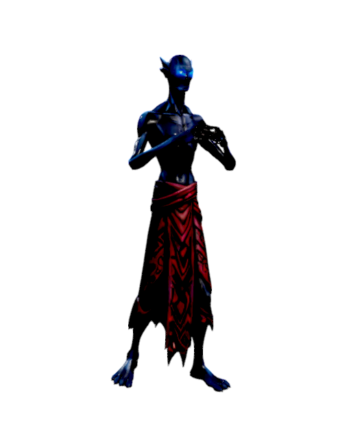
*From: Sumatera Utara · Style: Mystic · Power/Speed/Defense/Technique: 7/5/5/8*

A spirit from Batak tales that grows taller every time you look up at it. The longer you stare, the further you fall.

> Look up. Higher. Higher.

- **S**: Skyward Growth · **→ S**: Looming Gaze · **↓ S**: Long Shadow

| Input | Signature move | Kind | Meter | Effect |
|---|---|---|---|---|
| `↓ ↘ → + S` | **Pulled Upwards** | Lift & slam | 250 | The longer you look up, the higher you go. |
| `↓ ↙ ← + S` | **Toba Lightning** | Weather strike | 400 | Lightning from the storms over Lake Toba. |
| `↓ ↓ + S` | **Giant Shadow** | Summon | 700 | His shadow stands up on its own and stomps. |

| Input | Kind | Finisher |
|---|---|---|
| `← → ↓ H` | Fatality | Don't Look Up |
| `↑ ↓ → H` | Fatality | Toba Depths |
| `↓ ← → H` | Fatality | Endless Height |
| `↑ → ↓ L` | Brutality | Stilt Stomp |
| `← → ← L` | Brutality | Shadow Toss |
| `↓ ↑ ↓ S` | Friendship | Tor-tor Dance |
| `↑ ↑ → S` | Friendship | View from Above |
| `← ← ↓ G` | Mercy | Shrink Back |
| `← ↑ → H` | Legendary Finisher | Spirit of the Highlands |

### Leak — The Night Sorcerer

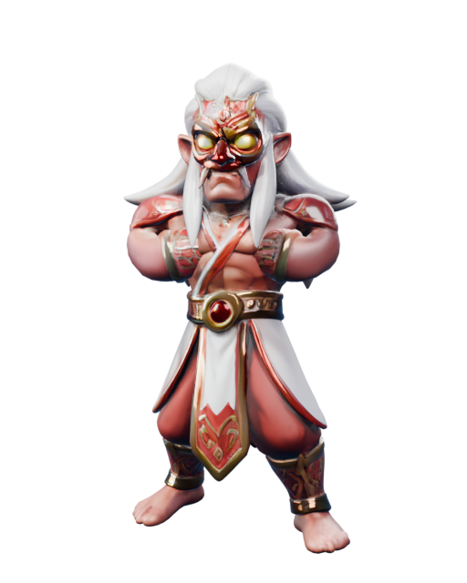
*From: Bali · Style: Mystic · Power/Speed/Defense/Technique: 6/7/5/9*

By day a quiet villager, by night a sorcerer of the Rangda tradition. Its head glows as it flies over the rice terraces.

> The night belongs to me.

- **S**: Leak Fire · **→ S**: Flying Head · **↓ S**: Desti Curse

| Input | Signature move | Kind | Meter | Effect |
|---|---|---|---|---|
| `↓ ↘ → + S` | **Leak Fire Rain** | Weather strike | 250 | Balls of cemetery fire fall like rain. |
| `↓ ↙ ← + S` | **Flying Heads** | Summon | 400 | Glowing heads leave their bodies and bite. |
| `↓ ↓ + S` | **Rangda's Vortex** | Tornado | 700 | A tornado of black magic fire. |

| Input | Kind | Finisher |
|---|---|---|
| `↓ ← → H` | Fatality | Rangda's Call |
| `↑ ↓ → H` | Fatality | Cemetery Flame |
| `↓ → ↓ H` | Fatality | Night Transformation |
| `↓ ↓ → L` | Brutality | Fireball Rain |
| `→ ← → L` | Brutality | Mask of Fear |
| `↓ ↑ ↓ S` | Friendship | Kecak Chorus |
| `→ → → S` | Friendship | Temple Offering |
| `← ← ↓ G` | Mercy | Balance Restored |
| `→ ↓ ← H` | Legendary Finisher | Sovereign of Shadows |

### Kuyang — The Flying Head

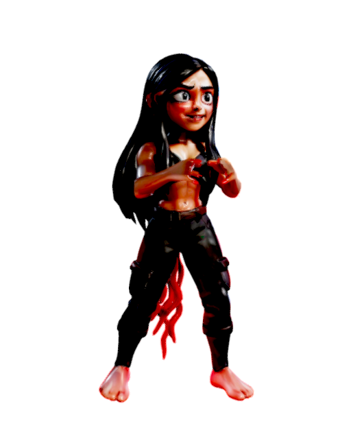
*From: Kalimantan · Style: Mystic · Power/Speed/Defense/Technique: 6/8/3/9*

At night her head leaves her body and flies over the river villages, trailing a red glow. Lock your windows.

> Did you lock the window?

- **S**: Crimson Trail · **→ S**: Head Dive · **↓ S**: Night Hunger

| Input | Signature move | Kind | Meter | Effect |
|---|---|---|---|---|
| `↓ ↘ → + S` | **Floating Heads** | Summon | 250 | Her sisters' heads glide in over the river. |
| `↓ ↙ ← + S` | **Night Drain** | Lift & slam | 400 | Lifts the victim with a red glow and drains them. |
| `↓ ↓ + S` | **Red Moon** | Weather strike | 700 | Strikes of red light from a red moon. |

| Input | Kind | Finisher |
|---|---|---|
| `← → ↓ H` | Fatality | Window Left Open |
| `↓ → ↓ H` | Fatality | River Shadow |
| `↑ ↓ → H` | Fatality | Red Lantern |
| `← → ← L` | Brutality | Hair Lash |
| `↑ → ↓ L` | Brutality | Spiral Dive |
| `→ → → S` | Friendship | Back to the Body |
| `↑ ↑ → S` | Friendship | Moon Dance |
| `↓ ↓ ↓ G` | Mercy | Spared at Dawn |
| `↑ ↑ ↓ H` | Legendary Finisher | Terror of Borneo |

### Baphomet — The Horned Outsider

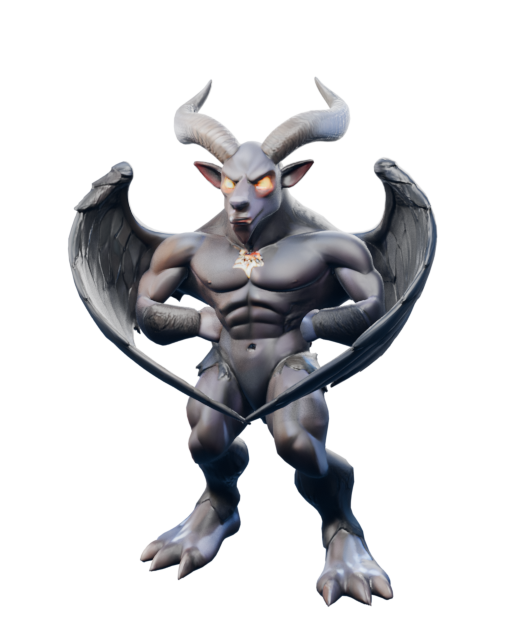
*From: Dunia Seberang · Style: Legend · Power/Speed/Defense/Technique: 9/5/7/7*

A horned outsider from a foreign legend, drawn by the tournament's thinning veil. The local spirits do not like it, and neither does the crowd.

> Mbeeek.

- **S**: Amber Hex · **→ S**: Horn Charge · **↓ S**: Wing Gust

| Input | Signature move | Kind | Meter | Effect |
|---|---|---|---|---|
| `↓ ↘ → + S` | **Amber Eclipse** | Weather strike | 250 | The sun goes dark and amber lightning falls. |
| `↓ ↙ ← + S` | **Shadow Goats** | Summon | 400 | Horned shadows gallop out of the dark. |
| `↓ ↓ + S` | **Dark Throne** | Lift & slam | 700 | Raises the opponent onto an invisible throne, then topples it. |

| Input | Kind | Finisher |
|---|---|---|
| `← → ↓ H` | Fatality | Goat's Judgement |
| `↑ ↓ → H` | Fatality | Eclipse |
| `→ → ← H` | Fatality | Horned Crown |
| `← → ← L` | Brutality | Hoof Stomp |
| `→ ← → L` | Brutality | Wing Flurry |
| `→ → → S` | Friendship | Petting Zoo |
| `↓ ↑ ↓ S` | Friendship | Grass Snack |
| `← ← ↓ G` | Mercy | Banished Home |
| `→ ↓ ← H` | Legendary Finisher | Lord of the Outer Dark |

### Ogoh-ogoh — The Parade Giant

*From: Bali · Style: Grappler · Power/Speed/Defense/Technique: 9/3/8/5*

A bamboo-and-paper demon built for the night before Nyepi, meant to carry away bad spirits and be burned. This one decided not to be burned.

> RAAAWR! (baleganjur intensifies)

- **S**: Bamboo Slam · **→ S**: Parade Stomp · **↓ S**: Baleganjur Roar

| Input | Signature move | Kind | Meter | Effect |
|---|---|---|---|---|
| `↓ ↘ → + S` | **Bearers' Parade** | Crowd charge | 250 | The bearers run the effigy through the crowd. |
| `↓ ↙ ← + S` | **Bamboo Stomp** | Quake | 400 | The bamboo frame slams down with the gamelan. |
| `↓ ↓ + S` | **Crossroads Spin** | Tornado | 700 | Spun three times at the crossroads, it becomes a storm. |

| Input | Kind | Finisher |
|---|---|---|
| `↓ → ↓ H` | Fatality | Pengerupukan |
| `← ← → H` | Fatality | Paper Mache Crush |
| `↓ ← → H` | Fatality | Spin of the Bearers |
| `↓ ↓ → L` | Brutality | Fang Bite |
| `→ ← → L` | Brutality | Bamboo Frame |
| `↓ ↑ ↓ S` | Friendship | Silent Day |
| `↑ ↑ → S` | Friendship | Parade Dance |
| `↓ ↓ ↓ G` | Mercy | Spared the Fire |
| `← ↑ → H` | Legendary Finisher | Demon of the Crossroads |

### Singo Barong — The Reog Ponorogo Dancer

*From: Ponorogo · Style: Beast · Power/Speed/Defense/Technique: 8/6/7/7*

The dancer carries a tiger mask and a peacock fan weighing as much as a person, using only his teeth. In the arena that jaw is a weapon.

> Hok-ya! Hok-ya!

- **S**: Peacock Fan · **→ S**: Barong Charge · **↓ S**: Warok Stomp

| Input | Signature move | Kind | Meter | Effect |
|---|---|---|---|---|
| `↓ ↘ → + S` | **Peacock Fan Storm** | Tornado | 250 | The giant peacock fan whips up a whirlwind. |
| `↓ ↙ ← + S` | **Jathilan Riders** | Crowd charge | 400 | Horse dancers gallop in on woven horses. |
| `↓ ↓ + S` | **Barong Bite** | Lift & slam | 700 | Lifts the opponent in the Singo Barong's jaws. |

| Input | Kind | Finisher |
|---|---|---|
| `← → ↓ H` | Fatality | Jaw of Iron |
| `→ → ← H` | Fatality | Peacock Storm |
| `↓ → ↓ H` | Fatality | Ponorogo Night |
| `↓ ↓ → L` | Brutality | Whip of the Warok |
| `↑ → ↓ L` | Brutality | Mask Smash |
| `↓ ↑ ↓ S` | Friendship | Jathilan Dance |
| `← ← ← S` | Friendship | Festival Parade |
| `↓ ↓ ↓ G` | Mercy | Bow of the Warok |
| `← ↑ → H` | Legendary Finisher | King of the Reog |

### Mbah Kerto — The Black Magic Shaman

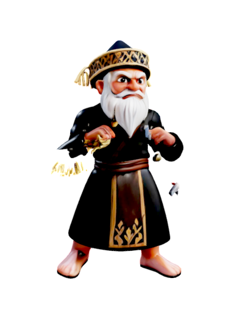
*From: Banyuwangi · Style: Mystic · Power/Speed/Defense/Technique: 5/5/6/10*

Kerto's clients come at midnight with a photo and a grudge. He fights with straw dolls, rusty nails and a kris that hums when someone lies.

> Bring me a photo.

- **S**: Rusty Nail Hex · **→ S**: Straw Doll · **↓ S**: Kris Curse

| Input | Signature move | Kind | Meter | Effect |
|---|---|---|---|---|
| `↓ ↘ → + S` | **Tuyul Delivery** | Summon | 250 | Sends his little helpers to pick your pockets, painfully. |
| `↓ ↙ ← + S` | **Voodoo Doll** | Lift & slam | 400 | Whatever happens to the doll happens to you. |
| `↓ ↓ + S` | **Rain of Nails** | Weather strike | 700 | Rusty nails fall from a clear sky. |

| Input | Kind | Finisher |
|---|---|---|
| `← → ↓ H` | Fatality | Midnight Package |
| `← ← → H` | Fatality | Pin Cushion |
| `→ → ← H` | Fatality | Seventh Night |
| `↑ → ↓ L` | Brutality | Kris Flurry |
| `← → ← L` | Brutality | Incense Choke |
| `→ → → S` | Friendship | Lucky Charm |
| `↑ ↑ → S` | Friendship | Love Potion |
| `← ← ↓ G` | Mercy | Curse Lifted |
| `→ ↓ ← H` | Legendary Finisher | Grand Master of the Dark Arts |

## Wildlife

### Si Ucok — The Forest Person

*From: Kalimantan · Style: Grappler · Power/Speed/Defense/Technique: 8/5/7/6*

Ucok guards the last stand of old forest with patience and enormous arms. He only fights when the chainsaws come.

> Hoo-hoo. (Leave the trees alone.)

- **S**: Durian Toss · **→ S**: Vine Swing · **↓ S**: Jungle Hug

| Input | Signature move | Kind | Meter | Effect |
|---|---|---|---|---|
| `↓ ↘ → + S` | **Durian Rain** | Barrage | 250 | Ripe, heavy and spiky. |
| `↓ ↙ ← + S` | **Forest Troop** | Crowd charge | 400 | The whole family swings in from the canopy. |
| `↓ ↓ + S` | **Vine Swing** | Lift & slam | 700 | Ties the opponent to a vine, swings, lets go. |

| Input | Kind | Finisher |
|---|---|---|
| `↓ → ↓ H` | Fatality | Canopy Drop |
| `← ← → H` | Fatality | Durian Crown |
| `→ → ← H` | Fatality | Branch Breaker |
| `← → ← L` | Brutality | Chest Drum |
| `↓ ↓ → L` | Brutality | Vine Tangle |
| `↓ ↑ ↓ S` | Friendship | Fruit Sharing |
| `→ → → S` | Friendship | Nest Building |
| `← ← ↓ G` | Mercy | Back to the Trees |
| `→ ↓ ← H` | Legendary Finisher | Guardian of Borneo |

### Pak Hidung — The Proboscis Monkey

*From: Banjarmasin · Style: Beast · Power/Speed/Defense/Technique: 5/9/5/7*

The pride of the mangroves, with a nose to match. He leaps between river boats faster than any ferry.

> Honk!

- **S**: Mighty Nose · **→ S**: Mangrove Leap · **↓ S**: Bekantan Call

| Input | Signature move | Kind | Meter | Effect |
|---|---|---|---|---|
| `↓ ↘ → + S` | **Proboscis Patrol** | Crowd charge | 250 | A dozen big noses, one direction. |
| `↓ ↙ ← + S` | **Barito Current** | Wave | 400 | Calls the river over its banks. |
| `↓ ↓ + S` | **Mangrove Spin** | Tornado | 700 | A whirl of mangrove leaves and river mud. |

| Input | Kind | Finisher |
|---|---|---|
| `↓ ← → H` | Fatality | Nose Dive |
| `→ → ← H` | Fatality | River Market Splash |
| `↓ → ↓ H` | Fatality | Mangrove Maze |
| `→ ← → L` | Brutality | Tail Spin |
| `↑ → ↓ L` | Brutality | Belly Bounce |
| `↓ ↑ ↓ S` | Friendship | Boat Ride |
| `↑ ↑ → S` | Friendship | Mangrove Picnic |
| `← ← ↓ G` | Mercy | Swim Away |
| `→ ↓ ← H` | Legendary Finisher | Prince of the Rivers |

### Ora — The Last Dragon

*From: Nusa Tenggara Timur · Style: Grappler · Power/Speed/Defense/Technique: 8/5/8/5*

Ora is old, patient and venomous. She can wait for days. Her bite does the rest.

> Hsssss.

- **S**: Venom Bite · **→ S**: Tail Lash · **↓ S**: Dragon Pounce

| Input | Signature move | Kind | Meter | Effect |
|---|---|---|---|---|
| `↓ ↘ → + S` | **Komodo Hatchlings** | Summon | 250 | Small, fast and already venomous. |
| `↓ ↙ ← + S` | **Venom Cloud** | Wave | 400 | A breath of venom that rolls across the floor. |
| `↓ ↓ + S` | **Tail Quake** | Quake | 700 | One swing of the tail, and the island shakes. |

| Input | Kind | Finisher |
|---|---|---|
| `← ← → H` | Fatality | Slow Venom |
| `↓ → ↓ H` | Fatality | Rinca Feast |
| `↓ ← → H` | Fatality | Dragon's Jaw |
| `↓ ↓ → L` | Brutality | Tail Whip Combo |
| `← → ← L` | Brutality | Death Roll |
| `↓ ↑ ↓ S` | Friendship | Sunbathing |
| `↑ ↑ → S` | Friendship | Island Tour |
| `↓ ↓ ↓ G` | Mercy | Not Worth Eating |
| `→ ↓ ← H` | Legendary Finisher | Ancient Dragon |

### Datuk Belang — The Sumatran Tiger

*From: Sumatera · Style: Beast · Power/Speed/Defense/Technique: 8/9/5/7*

Villagers call him Datuk out of respect. He moves through the tall grass without a sound and strikes before you hear the rustle.

> Grrrr...

- **S**: Striped Claw · **→ S**: Lightning Pounce · **↓ S**: Sumatran Roar

| Input | Signature move | Kind | Meter | Effect |
|---|---|---|---|---|
| `↓ ↘ → + S` | **Ancestor Tigers** | Summon | 250 | The spirits of old tigers run beside him. |
| `↓ ↙ ← + S` | **Roaring Storm** | Tornado | 400 | A roar that turns into a spinning gale. |
| `↓ ↓ + S` | **Giant Claw** | Signature weapon | 700 | A claw the size of a door, glowing with the forest's anger. |

| Input | Kind | Finisher |
|---|---|---|
| `← → ↓ H` | Fatality | Tall Grass |
| `→ → ← H` | Fatality | Kerinci Hunt |
| `↑ ↓ → H` | Fatality | Crimson Stripes |
| `← → ← L` | Brutality | Claw Frenzy |
| `↓ ↓ → L` | Brutality | Pounce and Pin |
| `→ → → S` | Friendship | Big Cat Nap |
| `↓ ↑ ↓ S` | Friendship | Play Fight |
| `↓ ↓ ↓ G` | Mercy | Respect Given |
| `→ ↓ ← H` | Legendary Finisher | Spirit of Sumatra |

### Cenderawasih — The Bird of Paradise Spirit

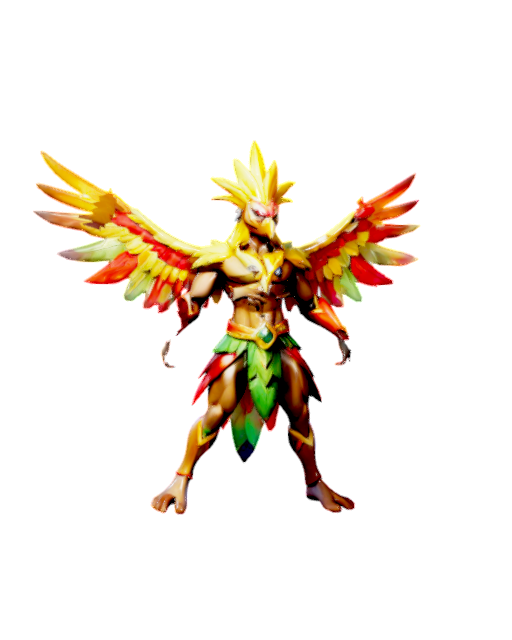
*From: Papua · Style: Mystic · Power/Speed/Defense/Technique: 5/9/4/9*

The spirit of the bird of paradise dances at the edge of the clouds. Its plumes cut like blades and shine like sunrise.

> Wak-wak-wak!

- **S**: Plume Dance · **→ S**: Dawn Wings · **↓ S**: Feather Storm

| Input | Signature move | Kind | Meter | Effect |
|---|---|---|---|---|
| `↓ ↘ → + S` | **Feather Storm** | Tornado | 250 | A cyclone of golden plumes, each one a blade. |
| `↓ ↙ ← + S` | **Paradise Flock** | Crowd charge | 400 | A flock of birds of paradise dives across the arena. |
| `↓ ↓ + S` | **Papuan Dawn** | Weather strike | 700 | Beams of the first sunrise strike the ground. |

| Input | Kind | Finisher |
|---|---|---|
| `→ → ← H` | Fatality | Plume Blades |
| `↑ ↓ → H` | Fatality | Paradise Lost |
| `↓ → ↓ H` | Fatality | Raja Ampat Dive |
| `↓ ↓ → L` | Brutality | Wing Flurry |
| `→ ← → L` | Brutality | Sky Spin |
| `← ← ← S` | Friendship | Courtship Dance |
| `↑ ↑ → S` | Friendship | Morning Song |
| `← ← ↓ G` | Mercy | Fly Free |
| `→ ↓ ← H` | Legendary Finisher | Herald of Paradise |

## Secret Legends

### Nyi Roro Kidul — Queen of the Southern Sea

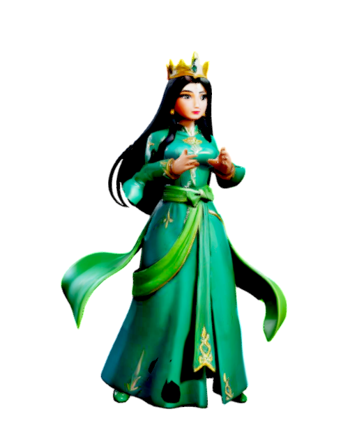
*From: Pantai Selatan · Style: Legend · Power/Speed/Defense/Technique: 8/7/8/10*

The queen of the southern ocean commands the waves themselves. Those who wear green on her beach are said to be called to her palace.

> The sea always takes back what is hers.

- **S**: Southern Wave · **→ S**: Green Sash · **↓ S**: Call of the Sea
- Unlock: Win the Story Campaign.

| Input | Signature move | Kind | Meter | Effect |
|---|---|---|---|---|
| `↓ ↘ → + S` | **Southern Tide** | Wave | 250 | The southern sea answers her call. |
| `↓ ↙ ← + S` | **Green Sash** | Lift & slam | 400 | Her sash lifts the opponent towards the waves. |
| `↓ ↓ + S` | **Ocean Storm** | Weather strike | 700 | Thunder over the black sand of Parangtritis. |

| Input | Kind | Finisher |
|---|---|---|
| `↑ ↓ → H` | Fatality | Undertow |
| `→ → ← H` | Fatality | Palace Beneath |
| `← ← → H` | Fatality | Tidal Judgement |
| `↑ → ↓ L` | Brutality | Sash Strangle |
| `← → ← L` | Brutality | Wave Barrage |
| `↑ ↑ → S` | Friendship | Pearl Gift |
| `→ → → S` | Friendship | Seashell Song |
| `← ← ↓ G` | Mercy | Returned to Shore |
| `↑ ↑ ↓ H` | Legendary Finisher | Sovereign of the Southern Sea |

### Gatotkaca — Muscles of Wire, Bones of Iron

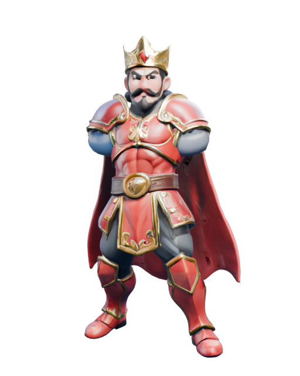
*From: Pringgandani · Style: Legend · Power/Speed/Defense/Technique: 9/8/9/7*

The flying knight of the wayang stage, son of Bima, forged in the cauldron of the gods. He fights from the sky.

> My muscles are wire, my bones are iron!

- **S**: Brajamusti Fist · **→ S**: Pringgandani Flight · **↓ S**: Antakusuma Shield
- Unlock: Win a Tournament on any difficulty.

| Input | Signature move | Kind | Meter | Effect |
|---|---|---|---|---|
| `↓ ↘ → + S` | **Brajamusti Lightning** | Weather strike | 250 | His fists call lightning down from heaven. |
| `↓ ↙ ← + S` | **Fly and Slam** | Lift & slam | 400 | Carries the opponent into the clouds, then down. |
| `↓ ↓ + S` | **Meteor Fist** | Quake | 700 | Falls from the sky like a meteor, fist first. |

| Input | Kind | Finisher |
|---|---|---|
| `↑ ↓ → H` | Fatality | Candradimuka Forge |
| `↓ ← → H` | Fatality | Sky Meteor |
| `← → ↓ H` | Fatality | Iron Bones |
| `→ ← → L` | Brutality | Wire Muscle Rush |
| `← → ← L` | Brutality | Brajamusti Barrage |
| `↓ ↑ ↓ S` | Friendship | Wayang Bow |
| `→ → → S` | Friendship | Flight Lesson |
| `↓ ↓ ↓ G` | Mercy | A Knight's Mercy |
| `→ ↓ ← H` | Legendary Finisher | Knight of the Sky |

### Si Pitung — The Robin Hood of Betawi

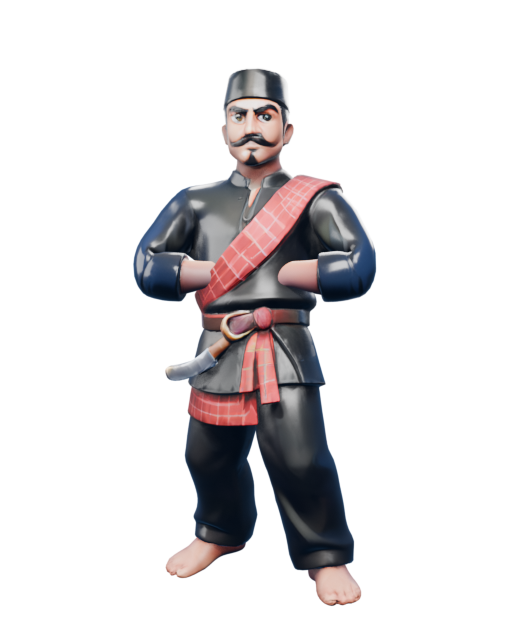
*From: Rawa Belong, Jakarta · Style: Legend · Power/Speed/Defense/Technique: 8/9/7/9*

The legendary jagoan of Betawi who took from the colonial landlords and gave to the kampung. Bullets, they say, never touched him.

> Don't mess with the kampung.

- **S**: Betawi Golok · **→ S**: Rawa Belong Silat · **↓ S**: Bulletproof
- Unlock: Reach Survival wave 10.

| Input | Signature move | Kind | Meter | Effect |
|---|---|---|---|---|
| `↓ ↘ → + S` | **Rawa Belong Golok** | Signature weapon | 250 | A golok that never misses an oppressor. |
| `↓ ↙ ← + S` | **Kampung Champions** | Crowd charge | 400 | Betawi fighters and ondel-ondel charge with him. |
| `↓ ↓ + S` | **Golok Volley** | Barrage | 700 | Throws golok after golok, each one returning to his hand. |

| Input | Kind | Finisher |
|---|---|---|
| `↓ ← → H` | Fatality | Golok Justice |
| `↑ ↓ → H` | Fatality | Kampung Revenge |
| `↓ → ↓ H` | Fatality | Rooftop Escape |
| `↑ → ↓ L` | Brutality | Sarong Snap |
| `← → ← L` | Brutality | Palang Pintu |
| `→ → → S` | Friendship | Share the Loot |
| `← ← ← S` | Friendship | Ondel-ondel Parade |
| `← ← ↓ G` | Mercy | Go Home to Your Mother |
| `→ ↓ ← H` | Legendary Finisher | Legend of Batavia |

### Sangkuriang — The Builder of Tangkuban Perahu

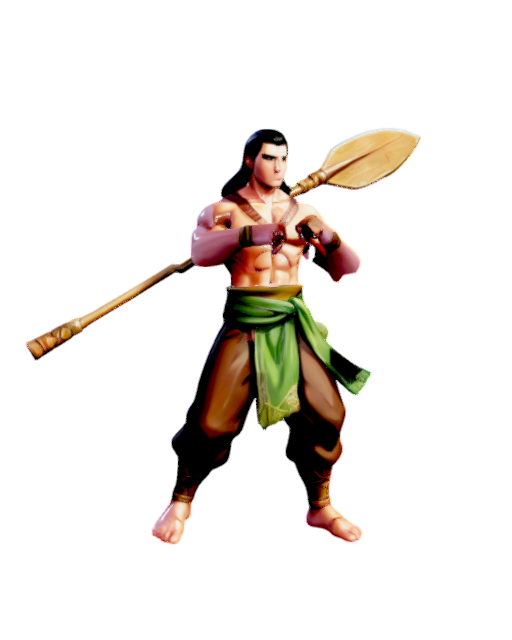
*From: Bandung · Style: Legend · Power/Speed/Defense/Technique: 10/6/7/7*

Tricked by a false dawn, he kicked his unfinished boat over and it became a mountain. He has been angry ever since.

> The sun has not risen yet!

- **S**: Boat Kick · **→ S**: Citarum Dam · **↓ S**: False Dawn
- Unlock: Perform 25 finishers.

| Input | Signature move | Kind | Meter | Effect |
|---|---|---|---|---|
| `↓ ↘ → + S` | **Giant Oar** | Signature weapon | 250 | The oar of the boat he never finished. |
| `↓ ↙ ← + S` | **Citarum Dam** | Wave | 400 | Releases the whole lake in one night. |
| `↓ ↓ + S` | **Boat Kick** | Quake | 700 | Kicks the boat over and it becomes a mountain. |

| Input | Kind | Finisher |
|---|---|---|
| `↓ ← → H` | Fatality | Tangkuban Perahu |
| `← ← → H` | Fatality | One Night Lake |
| `↓ → ↓ H` | Fatality | Mountain Maker |
| `↓ ↓ → L` | Brutality | Rage of Dawn |
| `→ ← → L` | Brutality | Hull Crusher |
| `→ → → S` | Friendship | Angklung Ensemble |
| `↑ ↑ → S` | Friendship | Boat Ride |
| `← ← ↓ G` | Mercy | Forgive the Past |
| `← ↑ → H` | Legendary Finisher | Wrath of Parahyangan |

### Jaka Tarub — The Celestial Thief

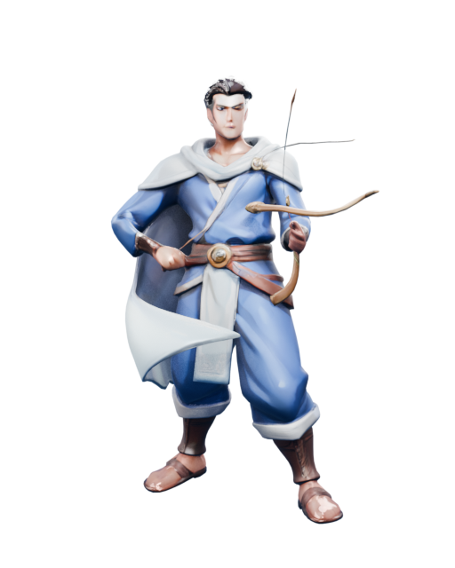
*From: Grobogan · Style: Legend · Power/Speed/Defense/Technique: 7/9/6/9*

He once hid a celestial nymph's shawl by the lake. Now he fights with the borrowed grace of heaven and a lot of regret.

> Some things should never be stolen.

- **S**: Heavenly Shawl · **→ S**: Kahyangan Arrow · **↓ S**: Nymph Lake
- Unlock: Earn 30 achievements.

| Input | Signature move | Kind | Meter | Effect |
|---|---|---|---|---|
| `↓ ↘ → + S` | **Heavenly Hoe** | Signature weapon | 250 | The farmer's pacul, blessed by the nymphs, comes down like a guillotine. |
| `↓ ↙ ← + S` | **Nymph Allies** | Summon | 400 | Seven nymphs descend, and they are not happy. |
| `↓ ↓ + S` | **Flying Shawl** | Lift & slam | 700 | The stolen shawl carries the opponent into the sky. |

| Input | Kind | Finisher |
|---|---|---|
| `← → ↓ H` | Fatality | Stolen Shawl |
| `← ← → H` | Fatality | Seventh Heaven |
| `↓ ← → H` | Fatality | Rice Barn Secret |
| `→ ← → L` | Brutality | Arrow Volley |
| `↑ → ↓ L` | Brutality | Lake Plunge |
| `← ← ← S` | Friendship | Return the Shawl |
| `→ → → S` | Friendship | Moonlight Bath |
| `↓ ↓ ↓ G` | Mercy | Heaven Forgives |
| `↑ ↑ ↓ H` | Legendary Finisher | Ascension |

## DLC Packs

### Sundel Bolong — The Hollow-Backed Lady

*From: Jawa · Style: Mystic · Power/Speed/Defense/Technique: 7/7/4/8*

Sundel Bolong joins Tarkam Arena in a downloadable content pack.

- **S**: Satay Order · **→ S**: Back Turn · **↓ S**: Wailing Night

| Input | Signature move | Kind | Meter | Effect |
|---|---|---|---|---|
| `↓ ↘ → + S` | **Spirit Call** | Summon | 250 | Spirits answer and attack. |
| `↓ ↙ ← + S` | **Night Lightning** | Weather strike | 400 | Lightning on command. |
| `↓ ↓ + S` | **Floating Curse** | Lift & slam | 700 | The curse lifts and drops its victim. |

| Input | Kind | Finisher |
|---|---|---|
| `→ → ← H` | Fatality | Night Terror |
| `← → ↓ H` | Fatality | Final Verdict |
| `← ← → H` | Fatality | Last Breath |
| `→ ← → L` | Brutality | Relentless Combo |
| `← → ← L` | Brutality | Total Beatdown |
| `↑ ↑ → S` | Friendship | Group Photo |
| `← ← ← S` | Friendship | Dance Battle |
| `↓ ↓ ↓ G` | Mercy | Walk Away |
| `↑ ↑ ↓ H` | Legendary Finisher | Legend Reborn |

### Tuyul — The Little Thief

*From: Jawa · Style: Striker · Power/Speed/Defense/Technique: 3/10/3/9*

Tuyul joins Tarkam Arena in a downloadable content pack.

- **S**: Coin Snatch · **→ S**: Wallet Dash · **↓ S**: Crab Distraction

| Input | Signature move | Kind | Meter | Effect |
|---|---|---|---|---|
| `↓ ↘ → + S` | **Cyclone Kick** | Tornado | 250 | A kick that becomes a cyclone. |
| `↓ ↙ ← + S` | **Blade Volley** | Barrage | 400 | A volley of thrown blades. |
| `↓ ↓ + S` | **Signature Blade** | Signature weapon | 700 | A heirloom blade, drawn at last. |

| Input | Kind | Finisher |
|---|---|---|
| `↓ → ↓ H` | Fatality | Night Terror |
| `↓ ← → H` | Fatality | Final Verdict |
| `→ → ← H` | Fatality | Last Breath |
| `↓ ↓ → L` | Brutality | Relentless Combo |
| `→ ← → L` | Brutality | Total Beatdown |
| `↑ ↑ → S` | Friendship | Group Photo |
| `↓ ↑ ↓ S` | Friendship | Dance Battle |
| `← ← ↓ G` | Mercy | Walk Away |
| `→ ↓ ← H` | Legendary Finisher | Legend Reborn |

### Palasik — The Head That Flies

*From: Sumatera Barat · Style: Mystic · Power/Speed/Defense/Technique: 6/8/4/8*

Palasik joins Tarkam Arena in a downloadable content pack.

- **S**: Night Flight · **→ S**: Soul Sip · **↓ S**: Minang Curse

| Input | Signature move | Kind | Meter | Effect |
|---|---|---|---|---|
| `↓ ↘ → + S` | **Spirit Call** | Summon | 250 | Spirits answer and attack. |
| `↓ ↙ ← + S` | **Night Lightning** | Weather strike | 400 | Lightning on command. |
| `↓ ↓ + S` | **Floating Curse** | Lift & slam | 700 | The curse lifts and drops its victim. |

| Input | Kind | Finisher |
|---|---|---|
| `← ← → H` | Fatality | Night Terror |
| `← → ↓ H` | Fatality | Final Verdict |
| `↑ ↓ → H` | Fatality | Last Breath |
| `→ ← → L` | Brutality | Relentless Combo |
| `↑ → ↓ L` | Brutality | Total Beatdown |
| `→ → → S` | Friendship | Group Photo |
| `← ← ← S` | Friendship | Dance Battle |
| `← ← ↓ G` | Mercy | Walk Away |
| `→ ↓ ← H` | Legendary Finisher | Legend Reborn |

### Bang Mamat — The Betawi Champion

*From: Jakarta · Style: Striker · Power/Speed/Defense/Technique: 7/8/6/8*

Bang Mamat joins Tarkam Arena in a downloadable content pack.

- **S**: Cingkrik Strike · **→ S**: Palang Pintu Rush · **↓ S**: Sarong Whip

| Input | Signature move | Kind | Meter | Effect |
|---|---|---|---|---|
| `↓ ↘ → + S` | **Cyclone Kick** | Tornado | 250 | A kick that becomes a cyclone. |
| `↓ ↙ ← + S` | **Blade Volley** | Barrage | 400 | A volley of thrown blades. |
| `↓ ↓ + S` | **Signature Blade** | Signature weapon | 700 | A heirloom blade, drawn at last. |

| Input | Kind | Finisher |
|---|---|---|
| `↑ ↓ → H` | Fatality | Night Terror |
| `→ → ← H` | Fatality | Final Verdict |
| `↓ ← → H` | Fatality | Last Breath |
| `↓ ↓ → L` | Brutality | Relentless Combo |
| `↑ → ↓ L` | Brutality | Total Beatdown |
| `↑ ↑ → S` | Friendship | Group Photo |
| `↓ ↑ ↓ S` | Friendship | Dance Battle |
| `← ← ↓ G` | Mercy | Walk Away |
| `→ ↓ ← H` | Legendary Finisher | Legend Reborn |

### Ki Jaro — The Banten Warrior

*From: Banten · Style: Brawler · Power/Speed/Defense/Technique: 8/7/7/7*

Ki Jaro joins Tarkam Arena in a downloadable content pack.

- **S**: Debus Fist · **→ S**: Golok Arc · **↓ S**: Iron Skin

| Input | Signature move | Kind | Meter | Effect |
|---|---|---|---|---|
| `↓ ↘ → + S` | **Kampung Barrage** | Barrage | 250 | Whatever is lying around, thrown hard. |
| `↓ ↙ ← + S` | **Call the Kampung** | Crowd charge | 400 | The whole neighbourhood joins in. |
| `↓ ↓ + S` | **Bamboo Pole** | Signature weapon | 700 | A long bamboo pole, swung wide. |

| Input | Kind | Finisher |
|---|---|---|
| `← → ↓ H` | Fatality | Night Terror |
| `↓ ← → H` | Fatality | Final Verdict |
| `→ → ← H` | Fatality | Last Breath |
| `← → ← L` | Brutality | Relentless Combo |
| `↑ → ↓ L` | Brutality | Total Beatdown |
| `↑ ↑ → S` | Friendship | Group Photo |
| `→ → → S` | Friendship | Dance Battle |
| `↓ ↓ ↓ G` | Mercy | Walk Away |
| `↑ ↑ ↓ H` | Legendary Finisher | Legend Reborn |

### Cak Ronggo — The Madura Fighter

*From: Madura · Style: Brawler · Power/Speed/Defense/Technique: 8/7/6/7*

Cak Ronggo joins Tarkam Arena in a downloadable content pack.

- **S**: Celurit Crescent · **→ S**: Karapan Charge · **↓ S**: Salt Wind

| Input | Signature move | Kind | Meter | Effect |
|---|---|---|---|---|
| `↓ ↘ → + S` | **Kampung Barrage** | Barrage | 250 | Whatever is lying around, thrown hard. |
| `↓ ↙ ← + S` | **Call the Kampung** | Crowd charge | 400 | The whole neighbourhood joins in. |
| `↓ ↓ + S` | **Bamboo Pole** | Signature weapon | 700 | A long bamboo pole, swung wide. |

| Input | Kind | Finisher |
|---|---|---|
| `↓ → ↓ H` | Fatality | Night Terror |
| `← → ↓ H` | Fatality | Final Verdict |
| `← ← → H` | Fatality | Last Breath |
| `↓ ↓ → L` | Brutality | Relentless Combo |
| `→ ← → L` | Brutality | Total Beatdown |
| `↓ ↑ ↓ S` | Friendship | Group Photo |
| `↑ ↑ → S` | Friendship | Dance Battle |
| `← ← ↓ G` | Mercy | Walk Away |
| `→ ↓ ← H` | Legendary Finisher | Legend Reborn |

### Mas Bimo — The Cyborg Rider

*From: Jakarta 2077 · Style: Striker · Power/Speed/Defense/Technique: 7/9/6/7*

Mas Bimo joins Tarkam Arena in a downloadable content pack.

- **S**: Order Accepted · **→ S**: Shortcut Boost · **↓ S**: Five-Star Rating

| Input | Signature move | Kind | Meter | Effect |
|---|---|---|---|---|
| `↓ ↘ → + S` | **Cyclone Kick** | Tornado | 250 | A kick that becomes a cyclone. |
| `↓ ↙ ← + S` | **Blade Volley** | Barrage | 400 | A volley of thrown blades. |
| `↓ ↓ + S` | **Signature Blade** | Signature weapon | 700 | A heirloom blade, drawn at last. |

| Input | Kind | Finisher |
|---|---|---|
| `↑ ↓ → H` | Fatality | Night Terror |
| `← ← → H` | Fatality | Final Verdict |
| `↓ → ↓ H` | Fatality | Last Breath |
| `↑ → ↓ L` | Brutality | Relentless Combo |
| `↓ ↓ → L` | Brutality | Total Beatdown |
| `← ← ← S` | Friendship | Group Photo |
| `→ → → S` | Friendship | Dance Battle |
| `← ← ↓ G` | Mercy | Walk Away |
| `→ ↓ ← H` | Legendary Finisher | Legend Reborn |

### Mbah Algo — The AI Shaman

*From: Cloud Server Bantul · Style: Mystic · Power/Speed/Defense/Technique: 5/6/6/10*

Mbah Algo joins Tarkam Arena in a downloadable content pack.

- **S**: Neural Mantra · **→ S**: Prediction Strike · **↓ S**: Hallucination

| Input | Signature move | Kind | Meter | Effect |
|---|---|---|---|---|
| `↓ ↘ → + S` | **Spirit Call** | Summon | 250 | Spirits answer and attack. |
| `↓ ↙ ← + S` | **Night Lightning** | Weather strike | 400 | Lightning on command. |
| `↓ ↓ + S` | **Floating Curse** | Lift & slam | 700 | The curse lifts and drops its victim. |

| Input | Kind | Finisher |
|---|---|---|
| `↓ → ↓ H` | Fatality | Night Terror |
| `↑ ↓ → H` | Fatality | Final Verdict |
| `← → ↓ H` | Fatality | Last Breath |
| `→ ← → L` | Brutality | Relentless Combo |
| `↓ ↓ → L` | Brutality | Total Beatdown |
| `↓ ↑ ↓ S` | Friendship | Group Photo |
| `↑ ↑ → S` | Friendship | Dance Battle |
| `↓ ↓ ↓ G` | Mercy | Walk Away |
| `→ ↓ ← H` | Legendary Finisher | Legend Reborn |

### Unit P-62 — The Drone Officer

*From: Jakarta 2077 · Style: Brawler · Power/Speed/Defense/Technique: 6/7/8/7*

Unit P-62 joins Tarkam Arena in a downloadable content pack.

- **S**: Ticket Laser · **→ S**: Siren Dash · **↓ S**: Drone Swarm

| Input | Signature move | Kind | Meter | Effect |
|---|---|---|---|---|
| `↓ ↘ → + S` | **Kampung Barrage** | Barrage | 250 | Whatever is lying around, thrown hard. |
| `↓ ↙ ← + S` | **Call the Kampung** | Crowd charge | 400 | The whole neighbourhood joins in. |
| `↓ ↓ + S` | **Bamboo Pole** | Signature weapon | 700 | A long bamboo pole, swung wide. |

| Input | Kind | Finisher |
|---|---|---|
| `↑ ↓ → H` | Fatality | Night Terror |
| `→ → ← H` | Fatality | Final Verdict |
| `↓ ← → H` | Fatality | Last Breath |
| `→ ← → L` | Brutality | Relentless Combo |
| `↑ → ↓ L` | Brutality | Total Beatdown |
| `↓ ↑ ↓ S` | Friendship | Group Photo |
| `↑ ↑ → S` | Friendship | Dance Battle |
| `← ← ↓ G` | Mercy | Walk Away |
| `→ ↓ ← H` | Legendary Finisher | Legend Reborn |

## City & Satire

### Pak Bambang — The Corrupt Official

*From: Ibu Kota · Style: Grappler · Power/Speed/Defense/Technique: 7/3/9/6*

Bambang has never signed anything without an envelope under it. He fights with a briefcase full of money and a lawyer on speed dial. Any resemblance to a real person is purely coincidental.

> I don't recall.

- **S**: Envelope Toss · **→ S**: Briefcase Bash · **↓ S**: Cash Shield

| Input | Signature move | Kind | Meter | Effect |
|---|---|---|---|---|
| `↓ ↘ → + S` | **Envelope Rain** | Barrage | 250 | Envelopes full of 'appreciation', thrown hard. |
| `↓ ↙ ← + S` | **Personal Bodyguards** | Crowd charge | 400 | Men in black suits clear the way. |
| `↓ ↓ + S` | **Cash Briefcase** | Signature weapon | 700 | A briefcase so full of cash it is a weapon. |

| Input | Kind | Finisher |
|---|---|---|
| `↓ ← → H` | Fatality | Budget Markup |
| `→ → ← H` | Fatality | Tender Rigged |
| `← ← → H` | Fatality | Golden Handshake |
| `← → ← L` | Brutality | Briefcase Barrage |
| `↑ → ↓ L` | Brutality | Paperwork Avalanche |
| `↓ ↑ ↓ S` | Friendship | Free Infrastructure |
| `↑ ↑ → S` | Friendship | Campaign Gift |
| `↓ ↓ ↓ G` | Mercy | Settled Out of Court |
| `→ ↓ ← H` | Legendary Finisher | Untouchable |

### Ibu Dewi — The Member of Parliament

*From: Senayan · Style: Mystic · Power/Speed/Defense/Technique: 5/5/7/8*

Dewi naps through the morning session and wakes up just in time for the vote. Her speeches are so long they count as a ranged attack. A fictional legislator.

> Your aspirations have been noted.

- **S**: Endless Speech · **→ S**: Walk Out · **↓ S**: Point of Order

| Input | Signature move | Kind | Meter | Effect |
|---|---|---|---|---|
| `↓ ↘ → + S` | **Endless Speech** | Wave | 250 | A speech so long the sound itself pushes people back. |
| `↓ ↙ ← + S` | **Study Trip Entourage** | Crowd charge | 400 | The whole committee, with luggage, back from abroad. |
| `↓ ↓ + S` | **Gavel Drop** | Weather strike | 700 | Giant gavels fall from the sky. Passed. |

| Input | Kind | Finisher |
|---|---|---|
| `→ → ← H` | Fatality | Bill Passed Overnight |
| `↓ ← → H` | Fatality | Recess Forever |
| `← ← → H` | Fatality | Gavel Drop |
| `↑ → ↓ L` | Brutality | Microphone Feedback |
| `← → ← L` | Brutality | Committee Pile-on |
| `↑ ↑ → S` | Friendship | Comparative Study Trip |
| `← ← ← S` | Friendship | Photo Op |
| `↓ ↓ ↓ G` | Mercy | Aspirations Received |
| `↑ ↑ ↓ H` | Legendary Finisher | Voice of the People |

### Bang Viral — The Political Buzzer

*From: Grup WhatsApp · Style: Striker · Power/Speed/Defense/Technique: 4/9/4/9*

Viral runs four hundred accounts from one bedroom. He can trend any hashtag before breakfast, and he will tag you in all of them.

> Retweet if you agree.

- **S**: Hashtag Storm · **→ S**: Bot Swarm Dash · **↓ S**: Cancel Culture

| Input | Signature move | Kind | Meter | Effect |
|---|---|---|---|---|
| `↓ ↘ → + S` | **Hashtag Storm** | Tornado | 250 | A trending topic you can actually get hit by. |
| `↓ ↙ ← + S` | **Bot Swarm** | Crowd charge | 400 | Four hundred anonymous accounts, all at once. |
| `↓ ↓ + S` | **Notification Spam** | Barrage | 700 | Every notification arrives at once, physically. |

| Input | Kind | Finisher |
|---|---|---|
| `↑ ↓ → H` | Fatality | Doxxed |
| `← ← → H` | Fatality | Trending Topic |
| `→ → ← H` | Fatality | Ratio'd |
| `→ ← → L` | Brutality | Spam Barrage |
| `← → ← L` | Brutality | Fake News |
| `↓ ↑ ↓ S` | Friendship | Follow Back |
| `← ← ← S` | Friendship | Giveaway |
| `← ← ↓ G` | Mercy | Account Suspended |
| `← ↑ → H` | Legendary Finisher | King of the Timeline |

### Kak Cleo — The Influencer

*From: Jakarta Selatan · Style: Striker · Power/Speed/Defense/Technique: 4/9/5/8*

Cleo has two million followers and a ring light on her back at all times. Every fight is content, and every combo is a reel.

> Don't forget to like and subscribe!

- **S**: Flash Selfie · **→ S**: Collab Dash · **↓ S**: Live Stream

| Input | Signature move | Kind | Meter | Effect |
|---|---|---|---|---|
| `↓ ↘ → + S` | **Ring Light Flash** | Barrage | 250 | Blinding beauty-mode flashes. |
| `↓ ↙ ← + S` | **Die-hard Fans** | Crowd charge | 400 | Fans with phones out stampede for a selfie. |
| `↓ ↓ + S` | **Going Viral** | Lift & slam | 700 | Lifted on a wave of views, then dropped by the algorithm. |

| Input | Kind | Finisher |
|---|---|---|
| `↓ ← → H` | Fatality | Unfollowed |
| `↓ → ↓ H` | Fatality | Viral for the Wrong Reasons |
| `→ → ← H` | Fatality | Ring Light Overload |
| `↑ → ↓ L` | Brutality | Selfie Stick Combo |
| `→ ← → L` | Brutality | Endorsement Deal |
| `← ← ← S` | Friendship | Shout Out |
| `↑ ↑ → S` | Friendship | Dance Challenge |
| `← ← ↓ G` | Mercy | Story Deleted |
| `← ↑ → H` | Legendary Finisher | Blue Tick Legend |

### Rizky — The Vocational Student

*From: Bekasi · Style: Brawler · Power/Speed/Defense/Technique: 6/8/5/6*

Rizky can rebuild a motorbike engine with his eyes closed. He shows up to every protest first and leaves last, with his school tie as a headband.

> Let's go, the workshop is calling!

- **S**: Wrench Throw · **→ S**: Belt Whip · **↓ S**: Engine Rev

| Input | Signature move | Kind | Meter | Effect |
|---|---|---|---|---|
| `↓ ↘ → + S` | **STM Convoy** | Crowd charge | 250 | The whole class arrives on loud bikes. |
| `↓ ↙ ← + S` | **Wrench Volley** | Barrage | 400 | Every spanner in the workshop, airborne. |
| `↓ ↓ + S` | **Gear Belt** | Signature weapon | 700 | A belt buckled with a motorbike sprocket. |

| Input | Kind | Finisher |
|---|---|---|
| `↑ ↓ → H` | Fatality | Tune Up |
| `→ → ← H` | Fatality | Open Exhaust |
| `← ← → H` | Fatality | Final Exam |
| `↓ ↓ → L` | Brutality | Wrench Combo |
| `← → ← L` | Brutality | School Brawl |
| `↑ ↑ → S` | Friendship | Fix Your Bike |
| `← ← ← S` | Friendship | Group Photo |
| `↓ ↓ ↓ G` | Mercy | Truce |
| `↑ ↑ ↓ H` | Legendary Finisher | Pride of the Workshop |

### Nadia — The Student Protester

*From: Depok · Style: Mystic · Power/Speed/Defense/Technique: 5/7/5/9*

Nadia leads the chants with a megaphone and the facts with footnotes. She has read every clause of the bill you are trying to pass.

> Read the bill first!

- **S**: Megaphone Blast · **→ S**: Long March · **↓ S**: Banner Sweep

| Input | Signature move | Kind | Meter | Effect |
|---|---|---|---|---|
| `↓ ↘ → + S` | **Call the Protesters** | Crowd charge | 250 | A column of students in campus jackets charges with banners. |
| `↓ ↙ ← + S` | **Thousand-Decibel Megaphone** | Wave | 400 | One chant through the megaphone, one shockwave. |
| `↓ ↓ + S` | **Banner Downpour** | Weather strike | 700 | Protest banners rain down from the overpass. |

| Input | Kind | Finisher |
|---|---|---|
| `↓ → ↓ H` | Fatality | Judicial Review |
| `← → ↓ H` | Fatality | Vote of No Confidence |
| `→ → ← H` | Fatality | Thesis Defence |
| `↓ ↓ → L` | Brutality | Chant Barrage |
| `← → ← L` | Brutality | Sign Smash |
| `→ → → S` | Friendship | Free Tutoring |
| `← ← ← S` | Friendship | Campus Concert |
| `↓ ↓ ↓ G` | Mercy | Peaceful Dialogue |
| `← ↑ → H` | Legendary Finisher | Voice of the Generation |

### Kang Asep — The Ride-Hailing Driver

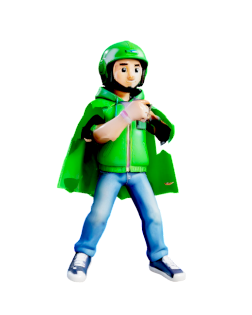
*From: Bandung · Style: Striker · Power/Speed/Defense/Technique: 6/9/5/6*

Asep knows every shortcut in the city and has a five-star rating to protect. Rain, traffic or a fighting tournament, the order gets delivered.

> Is this the right pickup point?

- **S**: Helmet Toss · **→ S**: Shortcut Rush · **↓ S**: Order Cancelled

| Input | Signature move | Kind | Meter | Effect |
|---|---|---|---|---|
| `↓ ↘ → + S` | **Ojol Convoy** | Crowd charge | 250 | Every driver in the city answers the call. |
| `↓ ↙ ← + S` | **Helmet Throw** | Barrage | 400 | Spare helmets for everyone, delivered at speed. |
| `↓ ↓ + S` | **Drift Tornado** | Tornado | 700 | Spins his bike so fast it becomes a tornado of smoke. |

| Input | Kind | Finisher |
|---|---|---|
| `↓ ← → H` | Fatality | One-Star Review |
| `↑ ↓ → H` | Fatality | Wrong Pin |
| `← ← → H` | Fatality | Rush Hour |
| `↑ → ↓ L` | Brutality | Helmet Combo |
| `← → ← L` | Brutality | Exhaust Burn |
| `← ← ← S` | Friendship | Free Delivery |
| `↓ ↑ ↓ S` | Friendship | Ride Home |
| `↓ ↓ ↓ G` | Mercy | Tip Included |
| `→ ↓ ← H` | Legendary Finisher | Legend of the Road |

### Ki Sarmin — The Debus Performer

*From: Banten · Style: Grappler · Power/Speed/Defense/Technique: 7/4/10/5*

Sarmin walks on glass, chews on fire and shrugs off machete blows in the Banten debus tradition. Hitting him mostly hurts your hand.

> Go on, hit me.

- **S**: Fire Breath · **→ S**: Glass Walk · **↓ S**: Iron Skin

| Input | Signature move | Kind | Meter | Effect |
|---|---|---|---|---|
| `↓ ↘ → + S` | **Flaming Golok** | Signature weapon | 250 | A golok wrapped in flame from his own breath. |
| `↓ ↙ ← + S` | **Fire Breath** | Barrage | 400 | Kerosene, a torch, and a very deep breath. |
| `↓ ↓ + S` | **Iron Body Blast** | Quake | 700 | Takes the hit, and the shockwave knocks everyone else down. |

| Input | Kind | Finisher |
|---|---|---|
| `← ← → H` | Fatality | Bed of Nails |
| `↓ ← → H` | Fatality | Fire Eater |
| `↓ → ↓ H` | Fatality | Golok Test |
| `↓ ↓ → L` | Brutality | Glass Shower |
| `→ ← → L` | Brutality | Iron Headbutt |
| `→ → → S` | Friendship | Village Show |
| `↑ ↑ → S` | Friendship | Teach the Kids |
| `← ← ↓ G` | Mercy | Not Today |
| `↑ ↑ ↓ H` | Legendary Finisher | Unbreakable Banten |

### Jerry — The Street Punk

*From: Bandung · Style: Striker · Power/Speed/Defense/Technique: 6/8/4/7*

Jerry plays three chords on a broken ukulele and shares his last rice with anyone. His mohawk is held up by sugar water and pure attitude.

> Oi! Oi! Oi!

- **S**: Ukulele Smash · **→ S**: Stage Dive · **↓ S**: Mosh Pit

| Input | Signature move | Kind | Meter | Effect |
|---|---|---|---|---|
| `↓ ↘ → + S` | **Full Distortion** | Wave | 250 | One chord through a broken amp. |
| `↓ ↙ ← + S` | **Mosh Pit** | Crowd charge | 400 | Every punk in Bandung pogos through the arena. |
| `↓ ↓ + S` | **Circle Pit** | Tornado | 700 | A circle pit so big it has its own weather. |

| Input | Kind | Finisher |
|---|---|---|
| `↓ ← → H` | Fatality | Anarchy in the Kampung |
| `→ → ← H` | Fatality | Safety Pin |
| `← ← → H` | Fatality | Feedback Loop |
| `← → ← L` | Brutality | Boot Stomp |
| `↑ → ↓ L` | Brutality | Circle Pit |
| `← ← ← S` | Friendship | Shared Rice |
| `↓ ↑ ↓ S` | Friendship | Street Gig |
| `← ← ↓ G` | Mercy | Peace, Bro |
| `→ ↓ ← H` | Legendary Finisher | Punk Never Dies |

### Bang Damar — The Forest Firefighter

*From: Riau · Style: Brawler · Power/Speed/Defense/Technique: 7/5/8/6*

Damar has spent every dry season inside the smoke of the peat fires. He fights with a high-pressure hose and the patience of someone who has seen the forest burn.

> Nobody burns my forest.

- **S**: Water Jet · **→ S**: Firebreak Charge · **↓ S**: Water Bomb

| Input | Signature move | Kind | Meter | Effect |
|---|---|---|---|---|
| `↓ ↘ → + S` | **High-Pressure Jet** | Wave | 250 | The hose at full pressure, aimed at you. |
| `↓ ↙ ← + S` | **Helicopter Water Bomb** | Weather strike | 400 | The water-bombing helicopter drops on his signal. |
| `↓ ↓ + S` | **Fire Axe** | Signature weapon | 700 | The axe that has cut a thousand firebreaks. |

| Input | Kind | Finisher |
|---|---|---|
| `→ → ← H` | Fatality | Smoke Out |
| `↓ → ↓ H` | Fatality | Peat Pit |
| `← ← → H` | Fatality | Pressure Max |
| `← → ← L` | Brutality | Hose Whip |
| `→ ← → L` | Brutality | Axe Combo |
| `← ← ← S` | Friendship | Plant a Tree |
| `→ → → S` | Friendship | Cool Down |
| `↓ ↓ ↓ G` | Mercy | Rescued |
| `↑ ↑ ↓ H` | Legendary Finisher | Guardian of the Peatlands |

### Mbak Lala — The Sound Horeg Dancer

*From: Malang · Style: Striker · Power/Speed/Defense/Technique: 5/9/4/8*

Lala dances in front of a sound-system wall taller than a house. The bass shakes roof tiles loose for three villages; she does not even blink.

> Turn it up!

- **S**: Bass Drop · **→ S**: Horeg Shuffle · **↓ S**: Subwoofer Slam

| Input | Signature move | Kind | Meter | Effect |
|---|---|---|---|---|
| `↓ ↘ → + S` | **Bass Drop** | Quake | 250 | Ten thousand watts of sub-bass hit the ground. |
| `↓ ↙ ← + S` | **Horeg Twister** | Tornado | 400 | She dances so hard the air starts spinning. |
| `↓ ↓ + S` | **Sound Truck Pass** | Crowd charge | 700 | A three-storey sound system rolls through the fight. |

| Input | Kind | Finisher |
|---|---|---|
| `→ → ← H` | Fatality | Roof Tiles Fall |
| `← ← → H` | Fatality | Ten Thousand Watts |
| `↑ ↓ → H` | Fatality | Speaker Wall |
| `→ ← → L` | Brutality | Bass Combo |
| `← → ← L` | Brutality | Shake Shake |
| `↓ ↑ ↓ S` | Friendship | Village Party |
| `→ → → S` | Friendship | Koplo Dance-off |
| `← ← ↓ G` | Mercy | Volume Down |
| `← ↑ → H` | Legendary Finisher | Queen of the Carnival |

