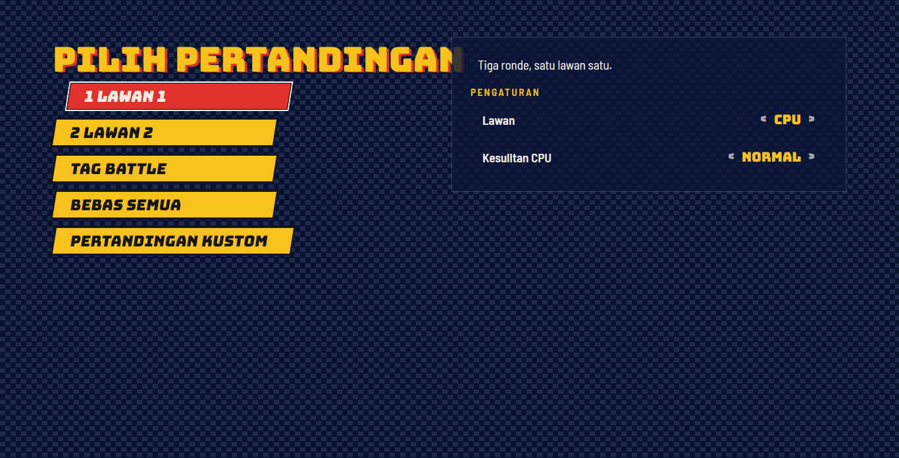
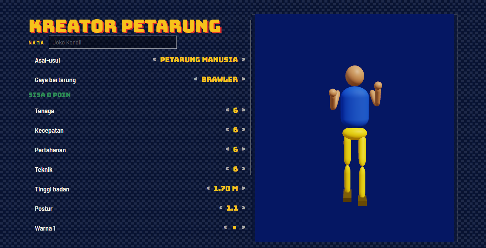

# How to play

## Controls

| Action | Player 1 | Player 2 | Gamepad |
|---|---|---|---|
| Move / walk back | A / D | ← / → | Left stick or D-pad |
| Jump | W | ↑ | Up |
| Crouch | S | ↓ | Down |
| Light attack | J | NumPad 1 | X / □ |
| Heavy attack | K | NumPad 2 | Y / △ |
| Grab & throw | L | NumPad 3 | B / ○ |
| Block (tap to parry) | U | NumPad 4 | RB / R1 |
| Special | I | NumPad 5 | A / ✕ |
| Dodge | O | NumPad 6 | LB / L1 |
| Tag partner | H | NumPad 0 | LT / L2 |
| Rage mode | Space | NumPad 7 | L3 / R3 |
| Pause | Esc or P | | Start |

Menus: arrow keys or WASD to move, Enter/J to confirm, Esc/K to go back, Q/E or Tab to switch tabs.

## Combat system

Matches run on a deterministic 60 Hz simulation with real frame data: every move has startup,
active and recovery frames, hitstun, blockstun and pushback.

| Mechanic | How it works |
|---|---|
| **Light attack** | Fast jab. Press Light again on hit to chain Jab → Cross → Hook (a target combo). |
| **Heavy attack** | Slow, strong overhead: it must be blocked standing. |
| **Low attack** | Down + Light. Must be blocked crouching (Down + Block). |
| **Launcher** | Down + Heavy. Pops the opponent into the air; press Up on hit to jump after them. |
| **Air combo** | Light/Heavy in the air. Each extra air hit pops the victim a little less (juggle decay); after six hits they drop. Air Heavy spikes them down. |
| **Grab & throw** | Unblockable at close range; swaps sides. Two grabs at the same time *tech* (both bounce apart). Grabs whiff on airborne opponents and opponents in hitstun. |
| **Counter** | A hit that lands during the opponent's startup is a counter hit: +25 % damage and longer hitstun. |
| **Parry** | Tap Block in the 6 frames before a hit lands: no damage, the attacker is stunned and you gain Adrenaline. |
| **Dodge** | A short sidestep/roll with invulnerability frames. Hold forward to roll through. |
| **Specials** | Special, Forward + Special and Down + Special (or the motions ↓↘→ + attack and →↓↘ + attack). Projectiles, lunges, teleports, command grabs, reversals and shockwaves depend on the fighter's style. Specials cancel out of normal moves that hit. |
| **Rage mode** | Taking damage fills the Rage meter (twice as fast below 25 % health). When it is full, press Rage: a burst knocks everyone back and you deal +25 % damage for 8 seconds. |
| **Adrenaline mode** | Landing hits and parries fills Adrenaline; when full it triggers on its own: faster walking and shorter recovery for 6 seconds. |
| **Team combo** | In 2 vs 2 and Tag Battle, hitting a victim your partner is comboing deals +20 % damage. In Tag Battle, tagging in while the opponent is in hitstun brings the partner in with a launcher. |
| **Combo scaling** | Each hit in a combo does 10 % less (down to 35 %). |

## Finishers

When the deciding round is won, the loser stands dazed and the screen says **HABISI!** (Finish them!).
The winner has about five seconds to enter a four-input sequence. The HUD shows your fighter's list;
the [fighter pages](characters.md) list every sequence.

| Kind | Per fighter | Effect |
|---|---|---|
| Fatality | 3 | The classic ending |
| Brutality | 2 | A brutal rush of hits |
| Friendship | 2 | Ends the fight with kindness (confetti included) |
| Mercy | 1 | The loser gets back up with 15 % health and the fight continues (once per match) |
| Legendary Finisher | 1 | Needs a roaring crowd (crowd meter ≥ 80 %) |

Sequences use F (towards the opponent), B (away), U, D, and L/H/G/S for Light, Heavy, Grab, Special.

## Game modes

| Mode | Description |
|---|---|
| 1 vs 1 | Best of three rounds |
| 2 vs 2 | Four fighters at once, two per team |
| Tag Battle | Two fighters per team, one on the field; KO'd point fighters are replaced by the partner |
| Free For All | Three or four fighters, everyone for themselves |
| Survival | Endless waves; health carries over, +20 % after each win; difficulty ramps up |
| Story Campaign | Nine chapters across Java, Borneo, Bali and the southern sea |
| Tournament | The eight-fighter Tarkam Cup: quarter-finals, semi-finals, final |
| Online Ranked | Rated matches through the matchmaking server, peer to peer with rollback |
| Clan Wars | Ranked wins earn points for your clan |
| Custom Match | Rounds, timer, damage, arena events and finishers are up to you |
| Training | Infinite time, health refills, no events |

## Living arenas

Every arena has its own locals (traders, drivers, students, warok, pecalang…). They walk, trade,
chat, cheer, film the fight on their phones, run away from finishers and **recognise certain
fighters**: market traders fear the Market Thug, students cheer the Student Protester, journalists
swarm the Corrupt Official, everyone flees the spirits.

Arena events happen during the fight: a loose chicken, a runaway cart, a raging goat, a bus arrival,
fruit-throwing orangutans, a rogue wave, the sound-horeg bass drop, a water cannon, a fire flare-up in
the peat forest, a motorbike swarm under the flyover. Events marked "affects the fight" are hazards
that knock fighters down (they flash a red warning first).

## Crowd

The crowd meter (the sound-system VU meter at the bottom of the HUD) rises with combos, counters,
parries, launchers, team combos and KOs, and slowly falls when nobody attacks. A loud crowd gives a
small adrenaline bonus and unlocks the Legendary Finisher. Your peak crowd becomes **crowd
reputation** for that fighter.

## Progression

Every match gives XP, coins and crowd reputation. Levels and coins unlock costumes, victory poses,
intros, emotes and banners in **Collection**. There are 42 achievements. Secret legends unlock as
follows:

| Legend | Unlock |
|---|---|
| Nyi Roro Kidul | Finish the Story Campaign |
| Gatotkaca | Win a Tournament |
| Si Pitung | Reach Survival wave 10 |
| Sangkuriang | Perform 25 finishers |
| Jaka Tarub | Earn 30 achievements |

## Fighter creator

Build a human fighter, a mystic creature or a regional champion: pick a style (brawler, striker,
grappler, mystic, beast), spend exactly 24 points on Power, Speed, Defense and Technique, set height,
build, colours and silhouette details, and watch the live 3D preview. Your fighters appear in the
"Your fighters" tab of character select, with their own specials and finishers.
