# Arenas

## Wet Market — Jakarta Timur

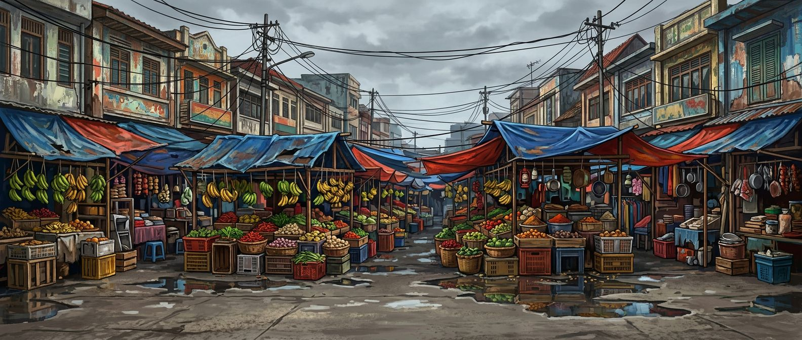

Puddles, tarpaulin roofs and a hundred haggling voices. Watch your step on the fish stall.

- Time / weather: Day / Cloudy · Music: Rock
- NPC: Trader, Shopper, Porter, VegetableSeller, Chicken
- **Loose chicken**: A chicken bolts across the arena.
- **Passing cart** (affects the fight): A cart rolls through and knocks fighters aside.
- **Raging goat** (affects the fight): A goat charges whoever is nearest.

## Central Java Rice Fields — Klaten

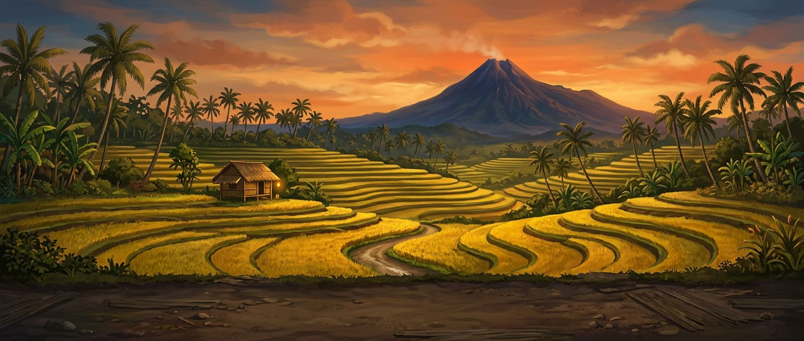

Golden paddies at dusk, with Merapi watching from the horizon.

- Time / weather: Dusk / Clear · Music: Gamelan
- NPC: Farmer, Buffalo, Kid, Musician
- **Harvest procession**: Villagers parade past with offerings.
- **Sudden downpour** (affects the fight): Rain makes the mud slippery.

## Parliament Steps — Senayan, Jakarta

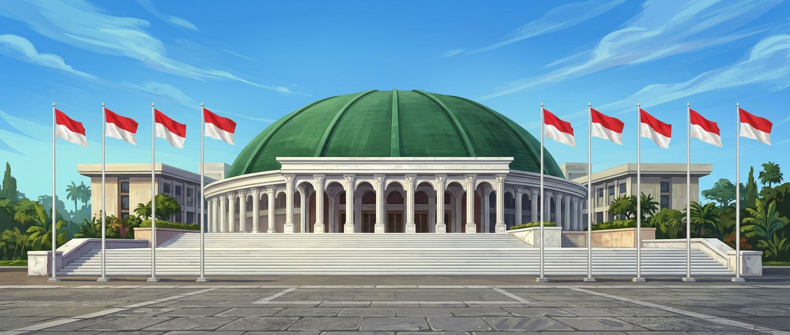

Marble steps in front of the green dome. Today's session is very lively.

- Time / weather: Day / Clear · Music: OrchestralHybrid
- NPC: Politician, Journalist, Officer, Photographer
- **Demonstration**: Protesters arrive with banners and megaphones.
- **Press flashes**: Every camera flashes at once.

## Busway Station — Jakarta Pusat

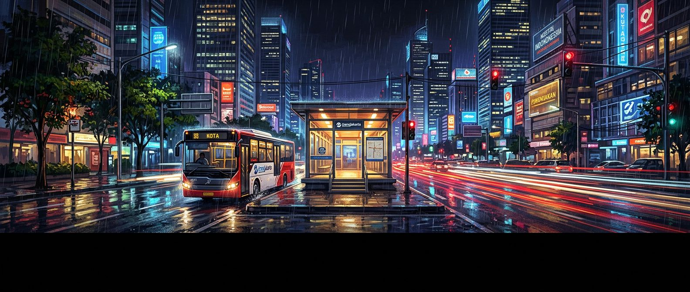

A glass bus shelter in the middle of the avenue at rush hour.

- Time / weather: Night / Rain · Music: Edm
- NPC: Commuter, Officer, Hawker
- **Bus arrival**: A bus pulls in and the doors slide open.
- **Passenger rush** (affects the fight): Commuters push through the fight.

## Kampung Rambutan Terminal — Jakarta Timur

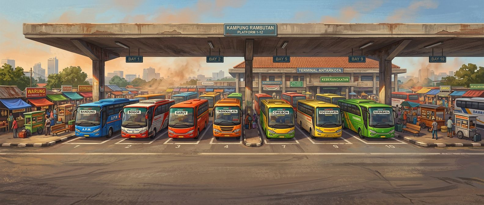

Diesel, shouting conductors and a bus to every city on Java.

- Time / weather: Day / Clear · Music: MetalHardcore
- NPC: Driver, Conductor, Passenger, Hawker
- **Bus arrival**: An intercity bus reverses into the bay.
- **Crowded platform** (affects the fight): Passengers flood the platform.

## Kampung Ambon — Jakarta Timur

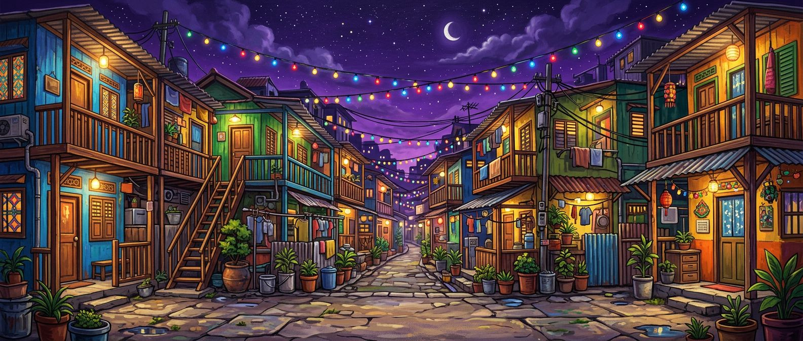

Narrow alleys strung with lights and music from every window.

- Time / weather: Night / Night · Music: Sasando
- NPC: Kid, Musician, Hawker, Shopper
- **Fireworks**: Someone is celebrating a wedding nearby.

## Borneo Rainforest — Kalimantan Tengah

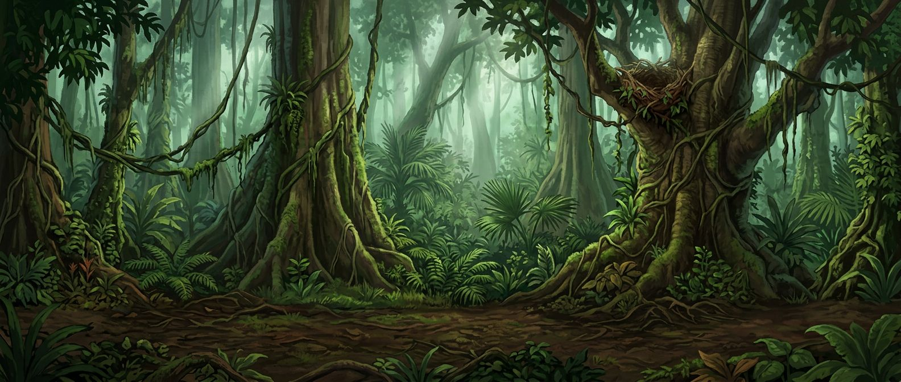

Giant trees, hanging vines and eyes watching from the canopy.

- Time / weather: Day / Fog · Music: Talempong
- NPC: Ranger, Researcher, OrangUtan
- **Fruit barrage** (affects the fight): Orangutans throw fruit at the fighters.
- **Falling tree** (affects the fight): A dead tree crashes across the arena.

## Southern Beach — Parangtritis

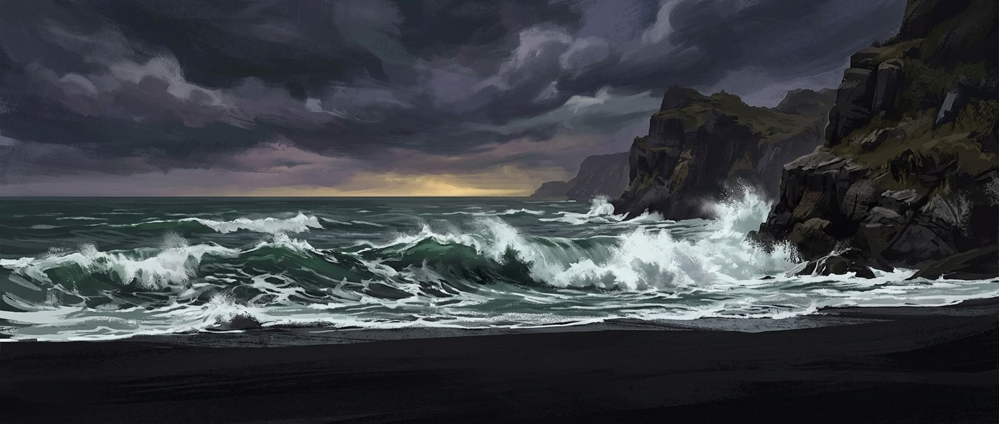

Black sand, roaring surf and a queen who does not like the colour green.

- Time / weather: Dusk / Storm · Music: OrchestralHybrid
- NPC: Fisherman, Tourist, Photographer
- **Rogue wave** (affects the fight): A wave sweeps the beach and drags fighters back.

## Old Town Jakarta — Jakarta Barat

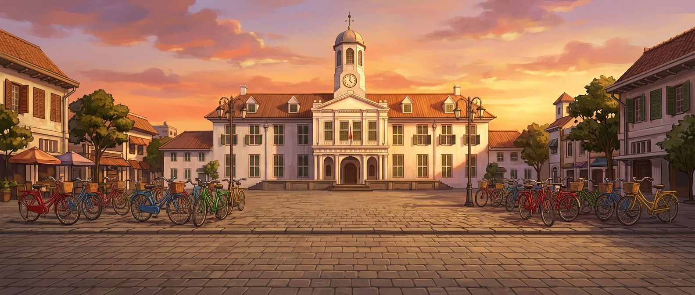

Colonial facades, rental bicycles and street performers frozen like statues.

- Time / weather: Dusk / Clear · Music: Angklung
- NPC: Tourist, Photographer, Musician, Hawker
- **Tour group**: A tour group stops to film the fight.

## Mount Bromo — Jawa Timur

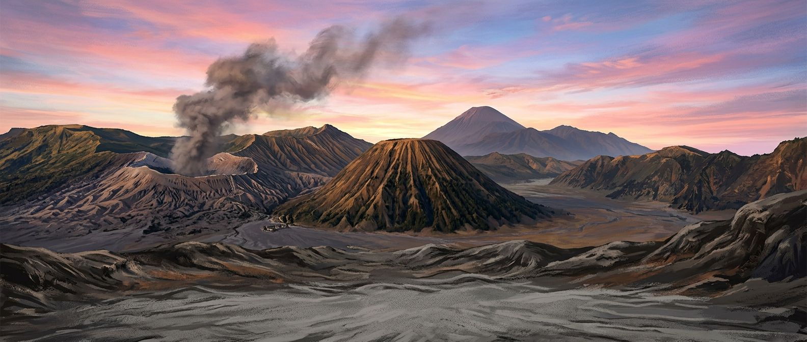

A sea of sand under a smoking crater at sunrise.

- Time / weather: Dawn / Ash · Music: DegungSunda
- NPC: Tourist, Monk, Photographer
- **Ash burst** (affects the fight): The crater coughs ash over the arena.
- **Kasada offering**: Pilgrims carry offerings towards the crater.

## Borobudur Temple — Magelang

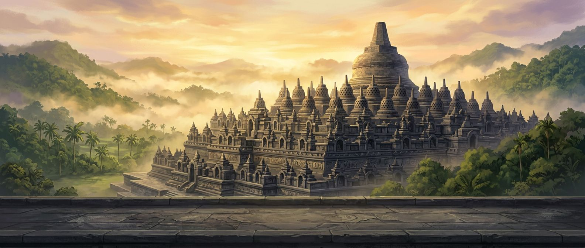

Stone terraces and bell-shaped stupas above the morning mist.

- Time / weather: Dawn / Fog · Music: Gamelan
- NPC: Monk, Tourist, Photographer
- **Lantern procession**: Monks walk the terraces with lanterns.

## Sound Horeg Carnival — Malang, Jawa Timur

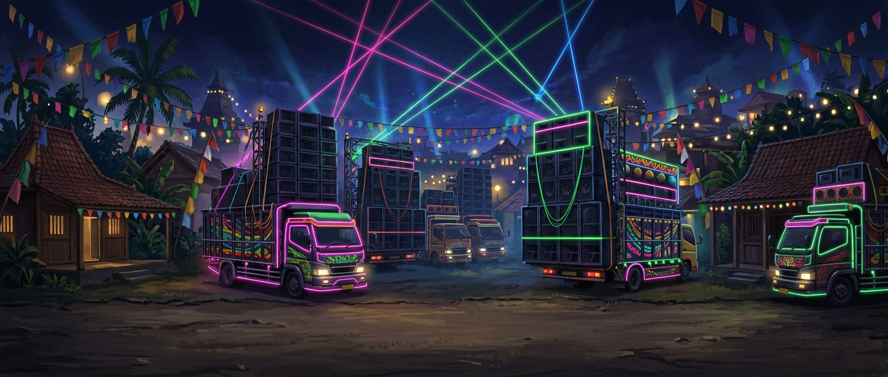

A village road lined with sound-system trucks stacked three storeys high. The bass is a weather system of its own.

- Time / weather: Night / Night · Music: Horeg
- NPC: Dancer, SoundCrew, Kid, Hawker, Villager
- **Bass drop** (affects the fight): The sound wall drops the bass and the shockwave throws fighters.
- **Sound truck parade**: Another sound truck crawls past, horns blaring.
- **Power cut**: The generator trips and the lights flicker out.

## Burning Peatland — Riau

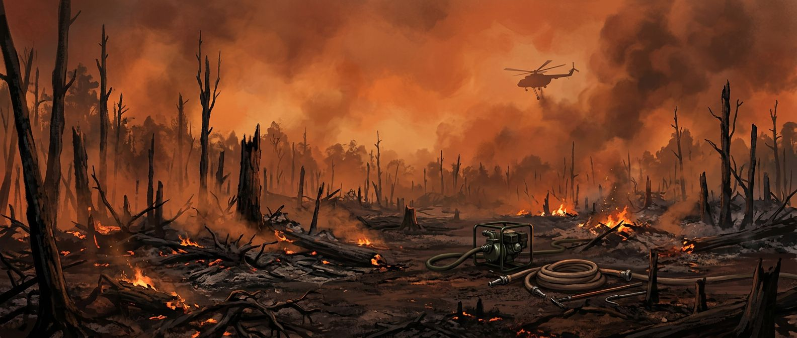

Orange smoke, smouldering peat and firefighters holding the line between the fire and the villages.

- Time / weather: Day / Ash · Music: MetalHardcore
- NPC: Firefighter, Villager, Ranger
- **Fire flare-up** (affects the fight): A patch of peat bursts into flame under the fighters.
- **Water bomb** (affects the fight): A helicopter drops water over the arena.

## Ponorogo Town Square — Ponorogo, Jawa Timur

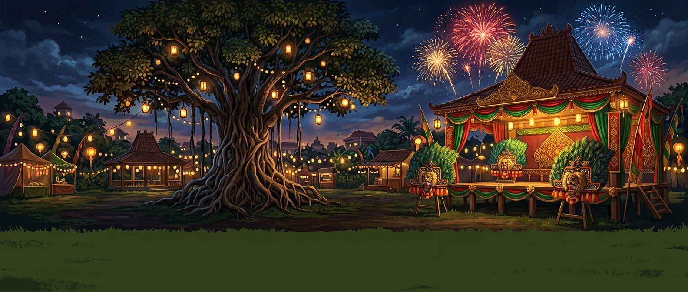

The Grebeg Suro festival: reog troupes, kendang drums and a square packed shoulder to shoulder.

- Time / weather: Night / Clear · Music: ReogGamelan
- NPC: Warok, Musician, Dancer, Tourist, Hawker
- **Reog parade**: A full reog troupe dances across the back of the square.
- **Festival fireworks**: Fireworks light up the night sky.

## Pengerupukan Night — Denpasar, Bali

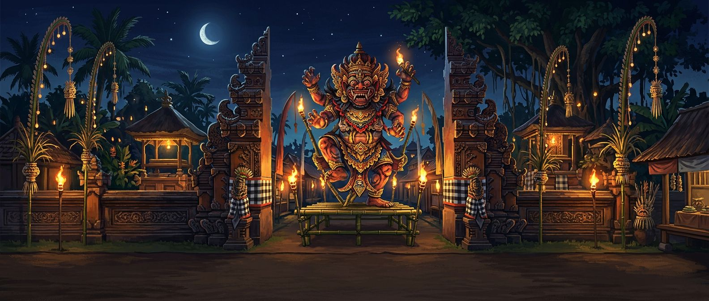

The night before Nyepi. Giant ogoh-ogoh effigies are spun at the crossroads to the crash of baleganjur.

- Time / weather: Night / Night · Music: Baleganjur
- NPC: Pecalang, Musician, Tourist, Kid
- **Ogoh-ogoh spin** (affects the fight): Bearers spin a giant effigy at the crossroads.
- **Torch flare**: Torches flare up along the road.

## Protest Avenue — Jakarta Pusat

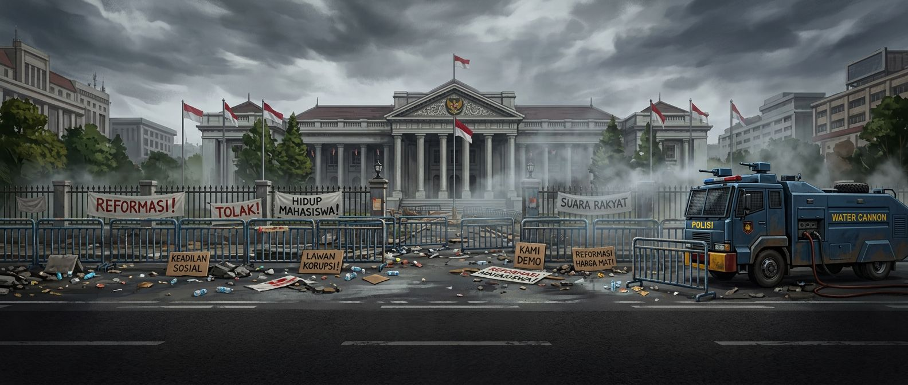

Students, banners and barricades in front of the government building. The water cannon truck is idling.

- Time / weather: Day / Cloudy · Music: Punk
- NPC: Student, Officer, Journalist, Hawker, Photographer
- **Water cannon** (affects the fight): A jet of water sweeps across the arena.
- **Tear gas**: A cloud drifts over the crowd and everyone coughs.
- **Long march**: A new column of protesters arrives singing.

## Under the Flyover — Jakarta Selatan

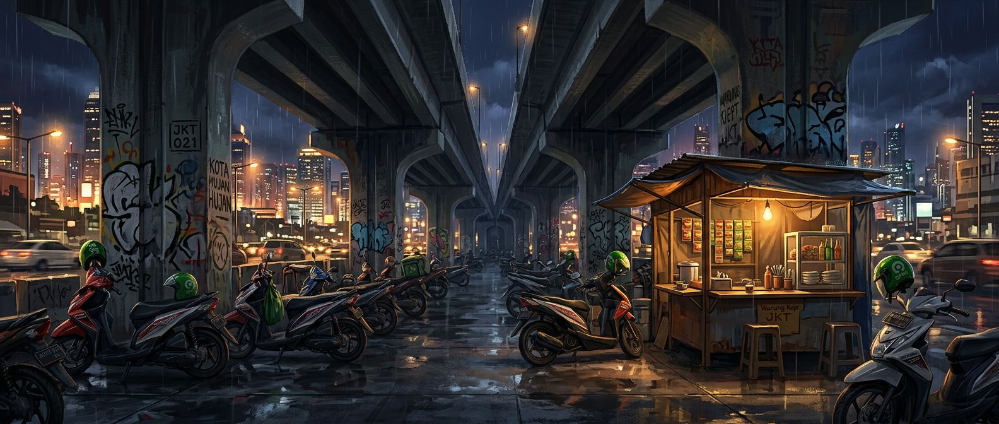

Under a concrete flyover at night, where a hundred drivers wait for orders and share one coffee stall.

- Time / weather: Night / Rain · Music: DangdutKoplo
- NPC: OjolDriver, Hawker, Commuter
- **Motorbike swarm** (affects the fight): A swarm of motorbikes cuts through the arena.
- **Downpour**: Rain hammers the flyover and everyone huddles closer.

## The Courtroom — Jakarta

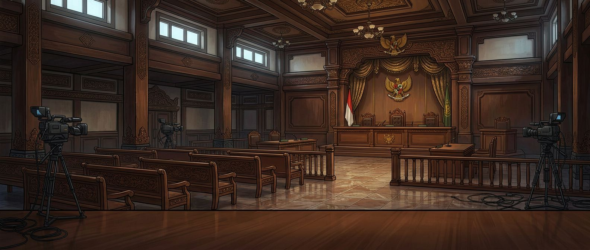

Wood panelling, a red-and-white flag and a gallery full of cameras. The verdict is very anticipated. A fictional courtroom.

- Time / weather: Day / Clear · Music: OrchestralHybrid
- NPC: Judge, Lawyer, Journalist, Officer, Politician
- **Camera flashes**: Every camera in the gallery flashes at once.
- **Order in the court**: The judge bangs the gavel and the gallery erupts.

