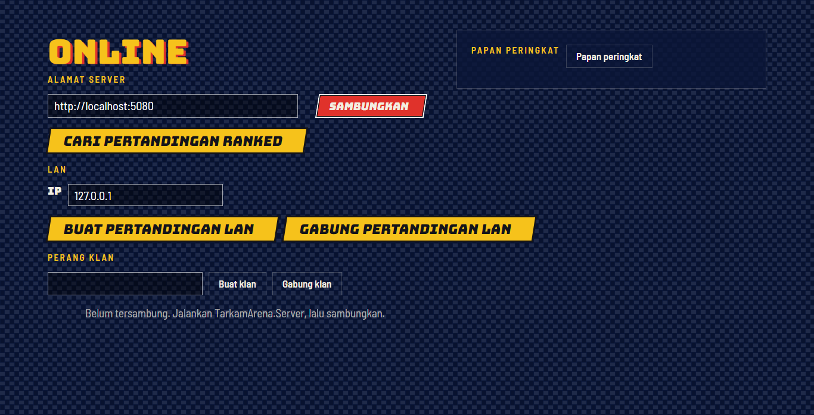

# Bermain online



## Cara kerja

Pertarungan berjalan **peer to peer** lewat UDP (LiteNetLib) dengan **rollback netcode** (`RollbackSession`):

- Setiap peer menerapkan inputnya sendiri dengan jeda 2 frame dan mengirim 8 input terakhir setiap
  tick, sehingga paket yang hilang tertutup oleh paket berikutnya.
- Input lawan diprediksi (input terakhir diulang). Bila input sebenarnya tiba dan berbeda, sesi
  memulihkan snapshot frame itu lalu mensimulasikan ulang sampai saat ini. Snapshot adalah salinan
  struct `MatchState`, jadi rollback tidak butuh alokasi.
- Bila sebuah peer lebih dari 8 frame di depan input terakhir yang terkonfirmasi, ia menunggu
  (sinkronisasi waktu).
- Setiap 60 frame terkonfirmasi, kedua peer membandingkan checksum state untuk mendeteksi desync.

Tes menjalankan dua sesi lewat loopback dengan latensi 4 frame dan kehilangan paket 20 %, serta dua
peer UDP sungguhan di localhost, dan memastikan keduanya berakhir di state yang sama.

## LAN / main langsung (tanpa server)

1. Pemain A: **Online → Buat pertandingan LAN**, pilih petarung. Game menunggu di UDP 7777.
2. Pemain B: isi alamat IP A, **Gabung pertandingan LAN**, pilih petarung.
3. Kedua peer bertukar handshake (nama, petarung; host memilih arena dan seed) lalu pertandingan dimulai.

Buka UDP 7777 di firewall host.

## Ranked, papan peringkat, dan klan

`TarkamArena.Server` menjembatani pertandingan ranked dan menyimpan rating:

```bash
dotnet run --project src/TarkamArena.Server                     # SQLite: tarkam-server.db
ConnectionStrings__Postgres="Host=db;Database=tarkam;Username=tarkam;Password=rahasia" \
  dotnet run --project src/TarkamArena.Server                   # PostgreSQL
```

| Endpoint | Fungsi |
|---|---|
| `/hubs/arena` (SignalR) | `JoinRankedQueue`, `LeaveQueue`, `ReportResult`, `Leaderboard`, `CreateClan`, `JoinClan`, `ClanStandings`; mengirim `MatchFound` |
| `GET /health` | Status, panjang antrean, dan jenis database |
| `GET /api/leaderboard?count=20` | Pemain teratas |
| `GET /api/clans` | Klasemen klan |

Matchmaker memasangkan pemain dengan selisih rating di bawah 100 poin, melebar 20 poin per detik
menunggu. Kedua pemain melaporkan hasil; hasil dihitung bila laporan keduanya cocok. Rating memakai
Elo (K = 32) dengan tingkatan Kampung, Kecamatan, Kabupaten, Provinsi, Nasional, dan Legenda.
Kemenangan ranked melawan klan lain memberi 10 poin perang untuk klanmu.

Di dalam game, isi alamat server di **Online** lalu tekan **Sambungkan**.

Uji cepat ke server yang sedang berjalan:

```bash
dotnet run --project tools/TarkamArena.Tools -- online-smoke http://localhost:5080
```

## Batasan dan langkah berikutnya

- Pemain dikenali lewat nama; akun dan autentikasi ada di peta jalan ([PLAN.md](../../PLAN.md)).
- Peer ranked tersambung langsung, jadi salah satunya butuh port UDP yang bisa dijangkau; NAT
  punch-through lewat `NatPunchModule` LiteNetLib direncanakan.
- Pertandingan online untuk dua pemain.
